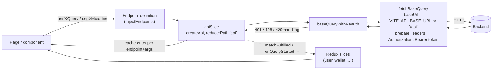

# Application architecture (User Panel)

This page explains how each reference User Panel boots, routes, authenticates, talks to the backend, stores data and stays up to date. Read it before any module page; module docs assume you know this.

- rsplay = `rsplay/rsplay-user@810884b`
- vishnu7 = `vishnu7/vishnu7user@6f3b811` (read at HEAD with `git show`)

Both are client-side single-page apps built with Vite + React 18 + TypeScript. Server state lives in **RTK Query** and client state in **Redux Toolkit** slices. Neither app uses WebSockets: all "live" data comes from **polling**. See [technology-stack.md](technology-stack.md) for versions.

---

## 1. The request pipeline at a glance

Both apps follow the same pattern. The repos differ in how the token is stored and in what happens on a 401.



`OBSERVED` in both repos: one `createApi` instance (`src/store/api/apiSlice.ts`) with `endpoints: () => ({})`. Each feature file adds its endpoints with `apiSlice.injectEndpoints(...)`. Because everything is one slice, **an endpoint name is a global cache key**. Two components that call the same hook with the same arguments share a single request and cache entry.

---

## 2. rsplay-user

### 2.1 Boot sequence
`OBSERVED`, from `src/main.tsx`:

```text
index.html → src/main.tsx
  registers service worker /sw.js (production only, on window 'load')
  <StrictMode> → <ErrorBoundary> → <ThemeProvider> → <Provider store> → <BrowserRouter>
       → <App/> + <Toaster/>
  side-effect imports: '@/i18n', globals.css
src/App.tsx
  useBfcacheAuthGuard()      – back-forward-cache restore without a token → window.location.replace('/')
  useReferralRegisterModal()
  useFcmNotifications()      – Firebase push registration (see FIREBASE_NOTIFICATIONS.md in the repo)
  VITE_MAINTENANCE_MODE === 'true' → only <MaintenancePage/>
  otherwise: <ScrollToTop/> <PushNotificationPrompt/> <Routes/> <ModalManager/>
```

### 2.2 Layout and routing
- Every real route is nested in **`HomeLayout`** (`src/layouts/HomeLayout.tsx`), which renders `Header`, `AlertNotification`, `Sidebar`, `<Outlet/>`, `Footer` and `MobileFooterBar`. Anything these components fetch is fetched on every page (see [polling inventory](../../inventory/polling-and-frequency-inventory.md)).
- Pages are lazy-loaded (`src/routes/index.tsx`, `loadable()`).
- **Login, signup and similar are modals, not routes.** `ModalManager` renders whichever modal `modalSlice` names. Code anywhere can open one with `dispatch(openModal({ name: 'login' }))`.
- `ProtectedRoute`: if the user is not authenticated it opens the login modal and runs `<Navigate to="/" replace state={{from}}/>`.
- `FeatureRoute`: gates `/deposit` and `/withdraw` using `/system` settings and the demo-user flag.
- The full route table is in [page-inventory.md](../../inventory/page-inventory.md#rsplay-user-810884b-srcapptsx).

### 2.3 Authentication and tokens
`OBSERVED`, from `src/store/slices/authSlice.ts` and `src/store/api/apiSlice.ts`:

| Concern | Implementation |
|---|---|
| Storage | `localStorage` keys `accessToken`, `refreshToken`, `user` |
| Startup | `getInitialState()` reads `localStorage`. The access token counts only if `!isTokenExpired(token)` (`src/utils/index.ts:119`); otherwise `isAuthenticated = false` |
| Header | `prepareHeaders` sets `authorization: Bearer <state.auth.accessToken \|\| state.auth.tempAuthToken>` and `content-type: application/json`, except for the `uploadFile` endpoint (multipart) |
| 401 handling | `baseQueryWithReauth` posts `POST /auth/refresh {refreshToken}`. On success it dispatches `setTokens` and **retries the original request once**. If the refresh fails or there is no refresh token, it dispatches `clearAuth()` |
| Back button after logout | `useBfcacheAuthGuard` forces a reload to `/` when a page restored from the back-forward cache has no token |

`INFERRED`: concurrent 401s each trigger their own `/auth/refresh` because there is no mutex or queue. Verification belongs to Phase 4 (shared auth).

### 2.4 Client state (Redux slices)
`OBSERVED`, from `src/store/index.ts`:

| Store key | Slice file | Fed by API? | Purpose (from names and matchers; detailed per module) |
|---|---|---|---|
| `api` | `store/api/apiSlice.ts` | — | RTK Query cache |
| `auth` | `slices/authSlice.ts` | login hooks dispatch `login` / `setTokens` | Tokens, user, `isAuthenticated` |
| `user` | `slices/userSlice.ts` | `getUserProfile.matchFulfilled`, `getIsMasterOwner.matchFulfilled` | Profile and master-owner flag |
| `wallet` | `slices/walletSlice.ts` | `getUserWallets.matchFulfilled` (via `@/apis/userApi`) | Balance, exposure, locked, bonus, coins |
| `betPlace` | `slices/betSlice.ts` (`name: 'bet'`) | dispatched by bet-slip code | Selected bet, P/L, limits (`setBetLimits`), loading |
| `oneClickBet` | `slices/oneClickBetSlice.ts` | `get/saveOneClickBetting` matchers | One-click on/off and default amount |
| `casino` | `slices/casinoGameDetailSlice.ts` | — | Selected casino game |
| `modal` | `slices/modalSlice.ts` | — | Which global modal is open |
| `ui`, `trigger` | `slices/uiSlice.ts`, `slices/triggerSlice.ts` | — | UI flags, cross-component triggers |

There is no `redux-persist`. Persistence is manual `localStorage` for auth only (`OBSERVED`). The `persist/*` actions ignored in `serializableCheck` are a template leftover.

### 2.5 API layer quirks you must know
- `src/apis/apiSlice.ts` is a **second, unused `createApi`**. Nothing imports it. The `src/apis/*Api.ts` files inject into `src/store/api/apiSlice.ts` like everything else.
- 11 endpoint names are defined twice (auth endpoints, `getUserProfile`, `getUserWallets`, `getNotifications`). See [api-inventory.md](../../inventory/api-inventory.md#rsplay-duplicate-endpoint-definitions) and Q-01 (resolved: only the definition in use is documented; `store/api/userApi.ts` and `store/api/notificationApi.ts` load first).

---

## 3. vishnu7user

### 3.1 Boot sequence
`OBSERVED`, from `src/main.tsx` and `src/App.tsx` at HEAD:

```text
src/main.tsx
  <StrictMode> → <ErrorBoundary> → <Provider store> → <BrowserRouter> → <App/> + <Toaster/>
  fonts: @fontsource/roboto-condensed (300/400/700)
src/App.tsx
  VITE_MAINTENANCE_MODE === 'true' → only <MaintenancePage/>
  otherwise <ScrollToTop/> + <Routes/>
```

It has no service-worker registration in `main.tsx`; `vite-plugin-pwa` handles the PWA side. There is also no i18n setup and no push-notification hook.

### 3.2 Layout and routing
- There are four layouts: `DashboardLayout` (`/dashboard`), `MainLayout` (home, sports, `/user/*`), `CasinoLayout` (`/casino*`) and `GameLayout` (`/game-details/...`, `/multi-market`). **All four render `Header` and `Sidebar`**, so `Header`'s 5 s polls run everywhere. `GameLayout` also renders `BettingContainer` (the bet slip). Every layout except `DashboardLayout` renders `Marquee`, the alert notifications.
- `/` redirects to `/dashboard`.
- `ProtectedRoute`: **guests and demo users** get `setLoginModalOpen(true)` and `<Navigate to="/home" replace/>`.
- `SelfRegisteredRoute` gates `/referral`.
- The full route table is in [page-inventory.md](../../inventory/page-inventory.md#vishnu7user-6f3b811-srcapptsx-at-head).

### 3.3 Authentication and tokens
`OBSERVED`, from `src/store/slices/authSlice.ts`, `src/store/api/apiSlice.ts` and `src/utils/index.ts`:

| Concern | Implementation |
|---|---|
| Storage | Cookie `access-token` (`js-cookie`), set by the `login` reducer. There is no refresh token |
| Source of truth for "logged in" | **The cookie**: `isGuestUser() = !Cookies.get('access-token')` (`utils/index.ts:11`). `Header` and `ProtectedRoute` use it. `state.auth.isAuthenticated` always starts as `false` and the `useIsAuthenticated` selector is commented out |
| Header | `prepareHeaders` reads the cookie on **every request**: `authorization: Bearer <cookie>` |
| 401 handling | `dispatch(logout())`, which removes the cookie. There is no refresh or retry. Separately, `getUserInfo.onQueryStarted` opens the login modal and removes the cookie on a 401 |
| 428 / 429 handling | `baseQueryWithReauth` shows a toast with the server `message`, or a default "Too many login attempts…" / "Precondition required…". The toast is suppressed for the `login` endpoint, which shows the error itself. The error `data.message` is normalised |
| MFA | `verifyTelegram` and `verifyNumber` are called from `OTPModal`. The setup and enable/disable endpoints are defined but unused (see [api-inventory](../../inventory/api-inventory.md)) |

### 3.4 Client state (Redux slices)
`OBSERVED`, from `src/store/index.ts`:

| Store key | Slice | Fed by API? | Purpose |
|---|---|---|---|
| `api` | `apiSlice` | — | RTK Query cache |
| `auth` | `authSlice` | `login` dispatch | Session and cookie management |
| `user` | `userSlice` | `getUserInfo.onQueryStarted` → `setUserInfo`. Wallets → `setWalletInfo` (`INFERRED` from the action name; confirm in Module 1) | Profile, wallets, stake settings, support info |
| `bet` | `betSlice` | dispatched by betting UI | `selectedBet`, `stakeAmount`, `betRate` |
| `media` | `mediaSlice` | `Media.tsx` dispatches `setMediaUrls` from `getMediaUrls` | Bet-slip open/close, `scorecardUrl`, `liveTvUrl` |
| `casino` | `casinoSlice` | — | `launchGame(url)` / `closeGame()` |
| `featureFlags`, `ui` | — | — | Flags, modals, sidebar, edit-stake |
| `mfa` | `mfaApi.reducer` | — | **Same reducer as `api`** (`mfaApi` is injected into `apiSlice`). Confirmed by the team as redundant; should be removed (Q-10) |

`src/store/slices/sportSlice.ts` exists but is not imported anywhere (`OBSERVED`).

---

## 4. Real-time model (both repos)

There are no sockets. Freshness comes entirely from RTK Query `pollingInterval`:

| Data | rsplay | vishnu7 |
|---|---|---|
| Market odds and status (game detail) | `/catalogue/:id` every 1 s in-play, 2 s otherwise | `/catalogue/:id` every 1 s |
| Fixture lists | `/fixture` every 2 s | `/fixture/groupByCompetition` every 3 s |
| Wallet / balance | `/users/me/wallets` every 5 s | `/users/me/wallets` + `/users/me` every 5 s |
| Raw cricket score | 1–2 s | 1 s |
| System settings | `/system` every 30 s (10 s on race pages) | — |

Polling continues in hidden tabs, and nothing is refetched on focus or reconnect. All details and file references are in [polling-and-frequency-inventory.md](../../inventory/polling-and-frequency-inventory.md).

---

## 5. Where to look first when debugging

| Symptom | rsplay | vishnu7 |
|---|---|---|
| Every request returns 401 | `authSlice` startup expiry check; `/auth/refresh` in `apiSlice.ts` | Is the `access-token` cookie present? `apiSlice.ts` logs out on 401 |
| A request goes to the wrong host | `VITE_API_BASE_URL` | `VITE_API_BASE_URL` |
| A page shows stale data | Is the component mounted, and is the `skip` condition true? See the polling inventory | Same |
| A protected page bounces to home | `ProtectedRoute` → `useAuth().isAuthenticated` | `ProtectedRoute` → cookie missing **or demo user** |
| The whole site shows maintenance | `VITE_MAINTENANCE_MODE` | `VITE_MAINTENANCE_MODE` |
