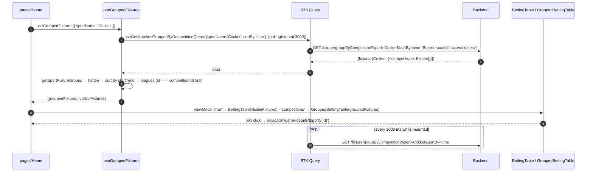

# Module 1: Home Page (API data flow)

These traces follow the most important home-page APIs end to end:

`Route → Component → Hook → Endpoint → HTTP → Response → Transformation → State → Component → UI`

Field-level request and response details are in [api-inventory.md](api-inventory.md). Paths are relative to `src/`.

---

## rsplay: match list (`getEvents`, 2 s)

```mermaid
sequenceDiagram
  autonumber
  participant R as Router "/"
  participant H as pages/Home
  participant L as SportsListing / SportsListingLogin
  participant F as useFixtureData
  participant Q as RTK Query (getEvents)
  participant B as baseQueryWithReauth
  participant API as Backend
  R->>H: HomeLayout → Outlet → Home
  H->>L: isAuthenticated ? SportsListingLogin : SportsListing
  L->>F: useFixtureData()  (no sportName)
  F->>F: queryParams = {sportName:'', competitionId:NaN, inplay:false, matchTime:'', status:'ACTIVE', search:''}
  F->>Q: useGetEventsQuery(queryParams, {pollingInterval:2000})
  Q->>B: {url:'/fixture?status=ACTIVE', method:'GET'}
  B->>API: GET {VITE_API_BASE_URL}/fixture?status=ACTIVE  (Authorization: Bearer … if logged in)
  API-->>B: {success, message, fixture:[…]}
  B-->>Q: data (401 → /auth/refresh → retry once)
  Q-->>F: data.fixture
  F->>F: transformEvents → Match[]; group by sport (cricket / soccer→football / tennis)
  F-->>L: {cricketEvents, footballEvents, tennisEvents, isLoading}
  L->>L: slice(0,3) guest | slice(0,5) logged in
  L-->>R: InplayRow × n (React.memo, re-renders only on price/tag changes)
  loop every 2000 ms while mounted
    Q->>API: GET /fixture?status=ACTIVE
  end
```

| Step | Where | What happens |
|---|---|---|
| 1. Called from | `pages/Inplay/Hooks/useFixtureData.ts:55` | `useGetEventsQuery` |
| 2. Responsible function | `eventsApi.getEvents.query` (`store/api/eventsApi.ts:299-314`) | Builds the `URLSearchParams`, keeping only truthy params |
| 3. Parameters | `useFixtureData.ts:41-53` | Only `status=ACTIVE` survives on `/` |
| 4. Headers / auth | `store/api/apiSlice.ts:8-21` | `authorization: Bearer <accessToken \|\| tempAuthToken>`, `content-type: application/json` |
| 5. Response received | RTK Query cache `api.queries["getEvents(<args>)"]` | |
| 6. Transformed | `useFixtureData.ts:61-99` | `transformEvents` (see the inventory) |
| 7. Fields extracted | `id, name, sport, startTime, inplay, marketId, isFancy, isBookmaker, isPremiumFancy, competition.name, runners[].{runnerName, backPrice1, backSize1, layPrice1, laySize1}` | |
| 8. Calculations | None. Prices are displayed as received | |
| 9. Stored | RTK cache only. Derived arrays are memoised per render (`useMemo`) | Nothing goes into Redux slices |
| 10. Consumers | `SportsListing`, `SportsListingLogin` (home), `pages/Inplay` (Module 2) | |
| 11. Displayed | `InplayRow`: LIVE badge or date, name, BM/Fancy/Premium icons, TV icon, 1/X/2 back/lay prices | |
| 12. Loading / error / empty | Spinner on the first load and on user-triggered refetches. `home.noActiveEvents` when the list is empty **or the request failed** (no error branch) | |

---

## rsplay: race cards (`getRaces`, 10 s)

```text
SportsListing (tab 4|5) / SportsListingLogin (always)
  → useGetRacesQuery({sportName:'HorseRacing'|'Greyhound', status:'ACTIVE'}, {pollingInterval:10000, skip?})
  → GET /fixture/race?sport=…&status=ACTIVE
  → data.fixture[]
      .filter(markets.length > 0)            [guest view: also drop fixtures with a 'forecast' market]
      .slice(0, 3 | 5)
  → RaceRow(data, path)
      markets − "to be placed" → sort by startTime → upcoming (start + 10 min ≥ now) or last 4
      → 4 (mobile) | 8 (desktop) time buttons, LIVE if now ≥ startTime
  → click: guest → openModal('login'); logged in → /details/{sport}/{id}/{market.externalId}
```

---

## rsplay: banners (`getBanners` × 4)

```text
MainBanner
  bannerType = isAuthenticated ? 'HomeBannerLogin' : 'HomeBanner'
  useGetBannersQuery({platform:'WebBanner', type:bannerType})  → GET /banners?platform=WebBanner&type=…
  useGetBannersQuery({platform:'AppBanner', type:bannerType})  → GET /banners?platform=AppBanner&type=…
  web  = data.data.WebBanner[bannerType] ?? []  → empty ? static mainBanners / mainBannersLogin
  app  = data.data.AppBanner[bannerType] ?? []  → empty ? static mainBannersMobile / mainBannersLogin
  → Swiper (autoplay 3 s, loop), desktop/mobile switched by CSS (both always rendered)
SecondaryBanner
  same pair with type 'SecondaryBanner' → slice(0,3) each → grid (desktop) / swiper (mobile); null if both empty
```

When the user logs in, `isAuthenticated` flips and `bannerType` changes. That gives new cache keys, so two **new** requests fire for `HomeBannerLogin` (`ON_STATE_CHANGE`). `INFERRED` from RTK Query keying.

---

## rsplay: deposit/withdraw visibility (`getSystemSettings` + profile)

```text
Header (layout)  → getUserProfile  → userSlice.profile        → useIsDemoUser()  (role.name === 'demo')
Header (layout)  → getIsMasterOwner → userSlice.isMasterOwnerUser → useIsMasterOwnerUser()
Home             → getSystemSettings (30 s) → systemSettings.deposit.selection / withdrawal.selection
showDeposit  = !isDemo && (isMasterOwner ? deposit.selection   : true)
showWithdraw = !isDemo && (isMasterOwner ? withdrawal.selection : true)
→ mobile-only buttons (sm:hidden) when isAuthenticated && (showDeposit || showWithdraw)
```

---

## vishnu7: cricket table on `/home` (`getMatchesGroupedByCompetition`, 3 s)



Auth difference from rsplay: the token is read from the `access-token` cookie on every request (`store/api/apiSlice.ts:8-15`). A 401 dispatches `logout()` with no refresh.

---

## vishnu7: casino game click from home (entry only; the full flow is in Module 8)

```text
CasinoGameCard.onPlay(id) | provider-group button → useCasinoGamePlay.playGame(id, provider='mac88')
  if gameLaunchLockedRef → ignore                       (prevents double launch)
  lock; launchingGameId = id                            (all cards disabled, spinner on this card)
  consent.requestConsent(launch)                        → CasinoConsentModal (useCasinoConsentGate)
  launch → useCasinoGameLauncher.launchCasinoGame(id, provider) → createCasinoSession → navigate('/casino-playground', …)
  finally: unlock after max(0, 3000 ms − elapsed)
```
