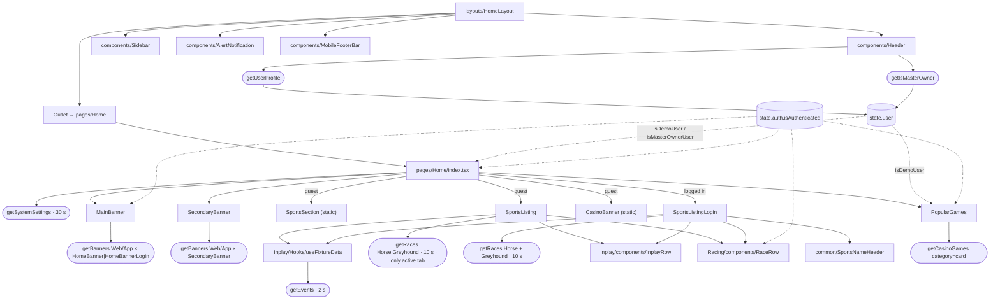
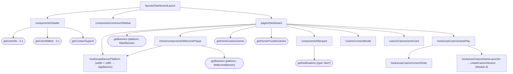
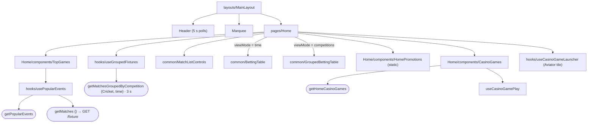

# Module 1: Home Page (component flow)

These are the component trees for the home pages, showing which component owns which API call and how data moves between them. Paths are relative to `src/`. Every edge is `OBSERVED` from imports and JSX unless labelled otherwise.

Legend: **solid boxes** are components, **rounded boxes** are RTK Query hooks (one cache entry per endpoint + arguments), and dashed arrows are Redux state reads.

---

## rsplay (`810884b`)

### Component responsibilities

| Component | File | API hooks | Reads from Redux | Renders / does |
|---|---|---|---|---|
| `Home` | `pages/Home/index.tsx` | `useGetSystemSettingsQuery` (30 s) | `auth.isAuthenticated`, `user.profile.role.name` (demo), `user.isMasterOwnerUser` | Chooses guest or logged-in sections. Mobile deposit/withdraw links |
| `MainBanner` | `pages/Home/components/MainBanner.tsx` | `useGetBannersQuery` ×2 | `auth.isAuthenticated` | Swiper, autoplay 3 s, desktop (`md:block`) and mobile (`md:hidden`) sets |
| `SecondaryBanner` | `pages/Home/components/SecondaryBanner.tsx` | `useGetBannersQuery` ×2 | — | Desktop 3-column grid; mobile swiper |
| `SportsSection` | `pages/Home/components/SportsSection.tsx` | — | — | Static sport images (6), not clickable |
| `SportsListing` | `pages/Home/components/SportsListing.tsx` | via `useFixtureData`; `useGetRacesQuery` ×2 | — | Tab strip and top-3 rows |
| `SportsListingLogin` | `pages/Home/components/SportsListingLogin.tsx` | via `useFixtureData`; `useGetRacesQuery` ×2 | — | Five stacked sections of top-5 rows |
| `useFixtureData` | `pages/Inplay/Hooks/useFixtureData.ts` | `useGetEventsQuery` (2 s) | — | Builds params, transforms, groups by sport. **Shared with Module 2** |
| `InplayRow` | `pages/Inplay/components/InplayRow.tsx` | — | `auth.isAuthenticated` (read but unused) | Match row, `React.memo` with a custom compare. Click → game detail |
| `RaceRow` | `pages/Racing/components/RaceRow.tsx` | — | `auth.isAuthenticated` | Race card with time buttons. Click → login modal or race detail |
| `CasinoBanner` | `pages/Home/components/CasinoBanner.tsx` | — | — | Static slider. Click → login modal |
| `PopularGames` | `pages/Home/components/PopularGames.tsx` | `useGetCasinoGamesQuery` | `auth.isAuthenticated`, demo flag | Swiper of up to 10 games. Click → `/GAME/:id` |

### Hidden dependencies
1. **The Home page needs Header's data.** `isDemoUser` and `isMasterOwnerUser` are derived from `state.user`, which only `getUserProfile` and `getIsMasterOwner` (fired by `Header`) fill (`store/slices/userSlice.ts`). Until those resolve, a logged-in demo user is briefly treated as non-demo, so the mobile deposit/withdraw links can flash (`INFERRED` from the data flow).
2. **`useFixtureData` lives in the In-play module.** Any change to it affects Home and In-play together. On `/` it runs with no sport, so it gets all sports in one request.
3. **Layout queries run alongside the page.** `Header`, `Sidebar`, `AlertNotification`, `HomeLayout` and `MobileFooterBar` all fire on `/`. See [api-inventory.md § Layout calls](api-inventory.md#layout-calls-that-also-run-on-the-home-page).

---

## vishnu7 (`6f3b811`)

### `/dashboard`

### `/home`

### Component responsibilities

| Component | File | API hooks | Notes |
|---|---|---|---|
| `Dashboard` | `pages/Dashboard/index.tsx` | `getBanners`, `getHomeCasinoGames`, `getHomeProviderGames` | Also renders `WelcomePopup`, `Marquee`, `CasinoConsentModal`, `Footer` |
| `WelcomePopup` | `pages/Home/components/WelcomePopup.tsx` | `getBanners(WellcomeBanner)` | **Fires for guests too** (no `skip`), although the popup only shows to logged-in users. Uses Redux `auth.isAuthenticated`, which is `false` after a page reload, so it shows only in the session right after login |
| `useBannerPlatform` | `hooks/useBannerPlatform.ts` | — | Starts as `WebBanner` and flips after mount. See [polling-and-frequency.md](polling-and-frequency.md#vishnu7) for the extra request this causes |
| `Home` | `pages/Home/index.tsx` | via `useGroupedFixtures` | `activeTab` is fixed to `'Cricket'` |
| `TopGames` | `pages/Home/components/TopGames.tsx` | via `usePopularEvents` | `hidden xl:block`. The CSS hides it but it stays mounted, so its queries always run |
| `usePopularEvents` | `hooks/usePopularEvents.ts` | `getPopularEvents`, `getMatches({})` | Fetches the whole fixture list only to build an `id → startTime` map |
| `useGroupedFixtures` | `hooks/useGroupedFixtures.ts` | `getMatchesGroupedByCompetition` (3 s) | **Shared with Module 2** (Inplay, Sports). Groups, flattens, sorts by time, then puts league entries first |
| `BettingTable` / `GroupedBettingTable` | `components/common/` | — | Row click → `/game-details/:sport/:id` |
| `CasinoGames` | `pages/Home/components/CasinoGames.tsx` | `getHomeCasinoGames` | Same endpoint and arguments as the Dashboard, so they share one cache entry |
| `useCasinoGamePlay` | `hooks/useCasinoGamePlay.ts` | — (delegates) | Consent gate, 3 s launch lock, `launchingGameId` |

Unused files in this module: `pages/Home/components/SportsTabs.tsx` is used only by `pages/Inplay`, and `pages/Home/components/GameCard.tsx` is imported nowhere. `OBSERVED`.
