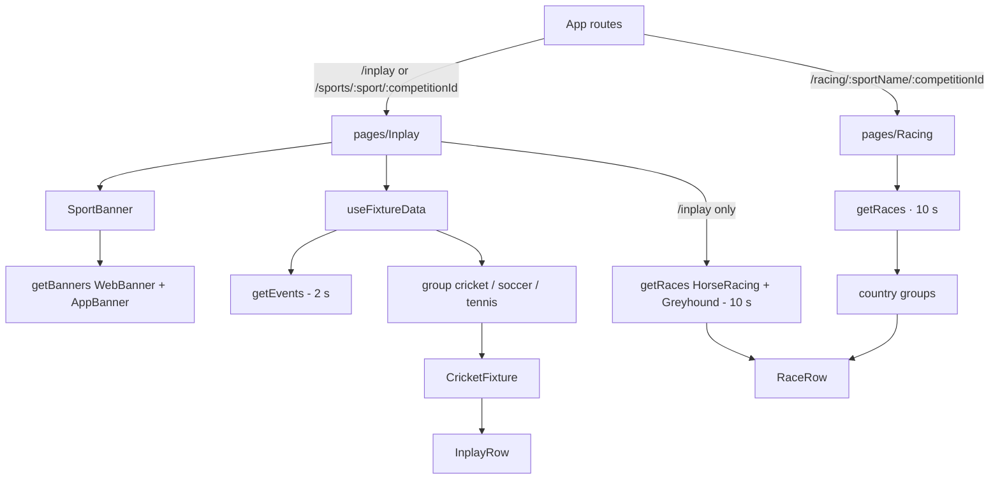
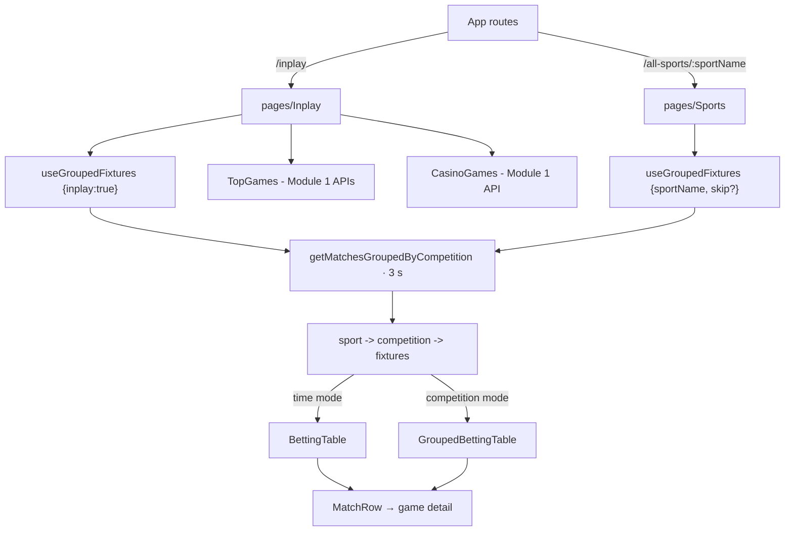

# Module 2: In-Play Fixtures (component flow)

Paths are relative to each repo's `src/`. Arrows are observed imports/JSX; query timing is described in [polling-and-frequency.md](polling-and-frequency.md).

## rsplay (`810884b`)

| Component / hook | File | Responsibility | Source |
|---|---|---|---|
| `Inplay` | `pages/Inplay/index.tsx` | Calls `useFixtureData`; on `/inplay`, adds horse and greyhound queries; conditionally renders sport and racing sections | `rsplay:src/pages/Inplay/index.tsx:19-41,62-137 (Inplay)` |
| `useFixtureData` | `pages/Inplay/Hooks/useFixtureData.ts` | Builds `/fixture` args, polls every 2 s, maps response fields, and groups three supported sports | `rsplay:src/pages/Inplay/Hooks/useFixtureData.ts:18-57,61-118 (useFixtureData)` |
| `CricketFixture` | `pages/Inplay/components/CricketFixture.tsx` | Shared sport header, rows, and per-sport empty state | `rsplay:src/pages/Inplay/components/CricketFixture.tsx:12-29 (CricketFixture)` |
| `InplayRow` | `pages/Inplay/components/InplayRow.tsx` | Displays event and prices; navigates to game detail | `rsplay:src/pages/Inplay/components/InplayRow.tsx:71-77,111-184 (InplayRow)` |
| `Racing` | `pages/Racing/index.tsx` | Polls one race sport; filters markets and groups fixtures by country | `rsplay:src/pages/Racing/index.tsx:19-52,87-99 (Racing)` |
| `RaceRow` | `pages/Racing/components/RaceRow.tsx` | Shows race times; guest click opens login, authenticated click opens race detail | `rsplay:src/pages/Racing/components/RaceRow.tsx:67-76 (RaceRow)` |
| `SportBanner` | `pages/Sports/components/SportBanner.tsx` | Requests desktop and mobile `SportBanner` banners, with a static fallback | `rsplay:src/pages/Sports/components/SportBanner.tsx:23-31 (SportBanner)` |

`SportsFilterBar` and `NotificationBar` are imported by `Inplay` but are not rendered in its JSX (`rsplay:src/pages/Inplay/index.tsx:3-6,62-137`, `Inplay`). Alerts on the route are supplied by the shared layout, not this `NotificationBar` (`rsplay:src/layouts/HomeLayout.tsx:14`, `HomeLayout`).

## vishnu7 (`6f3b811`)

| Component / hook | File | Responsibility | Source |
|---|---|---|---|
| `Inplay` | `pages/Inplay/index.tsx` | Fixes `activeTab` to `INPLAY`, requests all in-play sports, and switches local view mode | `vishnu7:src/pages/Inplay/index.tsx:11-31 (Inplay)` |
| `Sports` | `pages/Sports/index.tsx` | Requests a route sport, skipping recognized upcoming sports | `vishnu7:src/pages/Sports/index.tsx:11-19,29-50 (Sports)` |
| `useGroupedFixtures` | `hooks/useGroupedFixtures.ts` | Calls grouped-fixture endpoint, narrows by normalized sport, flattens and sorts | `vishnu7:src/hooks/useGroupedFixtures.ts:20-38 (useGroupedFixtures)` |
| `BettingTable` / `MatchRow` | `components/common/BettingTable.tsx` | Renders flat list and routes clicks to game detail | `vishnu7:src/components/common/BettingTable.tsx:17-31,51-65 (BettingTable, MatchRow)` |
| `GroupedBettingTable` | `components/common/GroupedBettingTable.tsx` | Renders fixture arrays under competition headings | `vishnu7:src/components/common/GroupedBettingTable.tsx:15-37 (GroupedBettingTable)` |
| `MatchListControls` | `components/common/MatchListControls.tsx` | Changes between time and competition presentation; does not change request args | `vishnu7:src/components/common/MatchListControls.tsx:11-40 (MatchListControls)` |
| `TopGames` | `pages/Home/components/TopGames.tsx` | Popular-event strip mounted on `/inplay`; its APIs are covered in Module 1 | `vishnu7:src/pages/Home/components/TopGames.tsx:7-25 (TopGames)` |
| `CasinoGames` | `pages/Home/components/CasinoGames.tsx` | Casino section mounted on `/inplay`; its API is covered in Module 1 | `vishnu7:src/pages/Inplay/index.tsx:7,19-31 (Inplay)` |