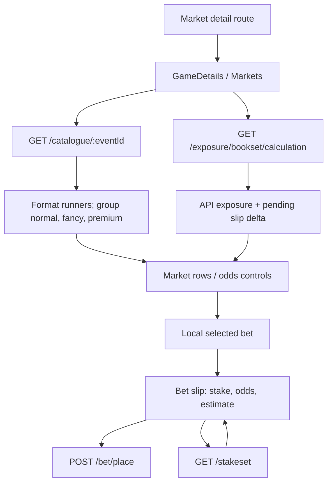

# Game Detail (component flow)

Paths are relative to the application source. This common map follows data from the catalogue to market rows, then into the bet slip and exposure display.

| Component / hook | Responsibility | Source |
|---|---|---|
| `GameDetails` / `useCatalogData` | Fetches event catalogue and media metadata; formats markets and limits | `src/pages/GameDetails/index.tsx:31-50 (GameDetails)`; `src/pages/GameDetails/Hooks/useCatalogData.ts:20-68 (useCatalogData)` |
| `Markets` | Fetches catalogue, chooses Odds / Bets / TV view, renders normal and fancy markets | `src/pages/Markets/index.tsx:14-40,113-175 (Markets)` |
| `NormalMarket` / `NormalRow` | Displays runner prices, selection limits, book/exposure and the bet action | `src/pages/Markets/components/NormalMarket.tsx:37-73,105-145 (NormalMarket)`; `src/pages/GameDetails/components/NormalRow.tsx (NormalRow)` |
| `BetSlip` / `useBetSlip` | Keeps current selection in local state, edits stake/odds, estimates profit, submits bet | `src/components/BetSlip.tsx:9-24,96-128,156-163 (BetSlip)`; `src/hooks/useBetSlip.ts:21-70 (useBetSlip)` |
| `Betslip` | Builds the bet request from the selected market, stake and odds | `src/components/Betslip.tsx:9-24,50-92 (Betslip)` |
| `useMarketExposureData` | Selects matching market and runner exposure from bookset data; adds local delta | `src/hooks/useMarketExposureData.ts:7-42 (useMarketExposureData)` |
| `useCashOut` / `useCashout` | Computes a candidate hedge and fills the bet slip; no separate cashout mutation | `src/pages/GameDetails/Hooks/useCashOut.tsx:39-68,184-236 (useCashOut)`; `src/hooks/useCashout.ts:33-68,141-182 (useCashout)` |

Scorecard, TV, raw-scorecard, and matched-bets components share the page but their APIs are documented with their respective modules. See [the User Panel map](../overview.md#module-3-game-detail-markets-book-limits-bet-placement).