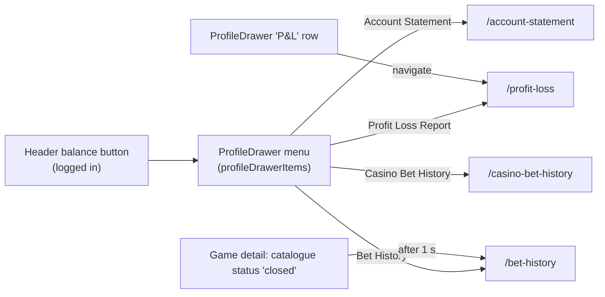
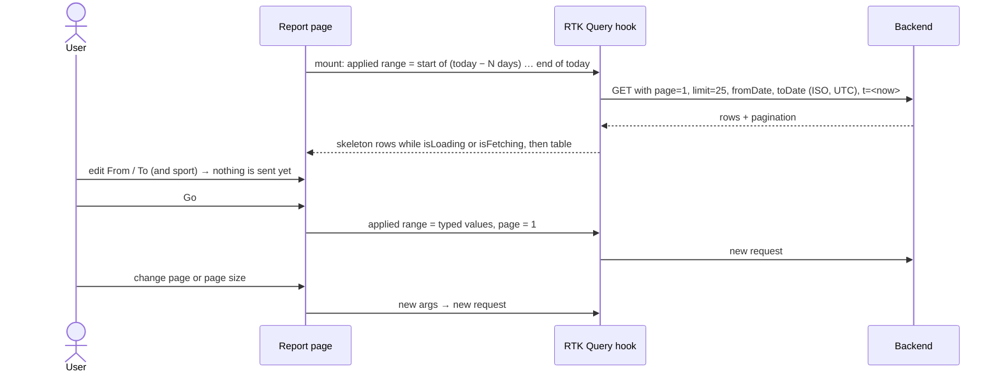

# Module 4: Reports (overview)

**Scope.** Four user reports: Account statement, Bet history, Profit & loss and Casino bet history. Other reports (Unsettled bets, Commission, Export report history, Bonus statement, Results) are deferred by team decision (2026-11-18).

**Reference.** rsplay only: `rsplay/rsplay-user@810884b`, read at `HEAD`. Paths are relative to `src/`. The team chose this on 2026-11-19. Other implementations use different routes, endpoints and drill-downs and are **not** covered here.

**Files in this module**

| File | What it covers |
|---|---|
| this page | Routes, entry points, the shared page pattern, findings |
| [account-statement.md](account-statement.md) | Wallet transactions, context filter, opening and closing balance, export |
| [bet-history.md](bet-history.md) | Settled sports bets, sport filter, columns, export |
| [profit-and-loss.md](profit-and-loss.md) | P&L per market, the casino variant, the two totals |
| [casino-bet-history.md](casino-bet-history.md) | Casino rounds, P/L formula, column mapping |
| [api-inventory.md](api-inventory.md) | Every report API: request, response fields, consumer |
| [polling-and-frequency.md](polling-and-frequency.md) | When each report request runs (there is no polling) |

---

## Routes

All four routes are children of `ProtectedRoute` inside `HomeLayout` (`App.tsx:92-100`). Pages are lazy-loaded (`routes/index.tsx:8-15`).

| Route | Page component | API | Default date range |
|---|---|---|---|
| `/account-statement` | `pages/Reports/AccountStatement.tsx` | [`GET /users/me/transactions`](api-inventory.md#s1-getmytransactions) | last 25 days |
| `/bet-history` | `pages/Reports/BetHistory.tsx` | [`GET /bet/history`](api-inventory.md#s3-getbethistory) (`betTime=PAST`) | last 15 days |
| `/profit-loss` | `pages/Reports/BetProfitLoss.tsx` | [`GET /bet/profit-loss`](api-inventory.md#s5-getprofitloss) (two calls) | last 2 days |
| `/casino-bet-history` | `pages/Reports/CasinoBetHistory.tsx` | [`GET /casino/round/history`](api-inventory.md#s6-getcasinoroundhistory) | last 7 days |

**Guests.** `ProtectedRoute` opens the login modal and redirects to `/` with `state.from` (`components/common/ProtectedRoute.tsx:12-28`). See [application architecture §2.2](../../00-overview/application-architecture.md#22-layout-and-routing).

## Entry points

| From | To | How | Source |
|---|---|---|---|
| Profile drawer menu (opened by the balance button in the header, `Header.tsx:170-176`) | all four reports | `NavLink` per item of `profileDrawerItems` | `utils/constants.ts:295-331`; `components/ProfileDrawer.tsx:208-237` |
| Profile drawer "P&L" row | `/profit-loss` | `onClose(); navigate('/profit-loss')` (not for demo users) | `components/ProfileDrawer.tsx:124-139` |
| Game detail page | `/bet-history` | `setTimeout(() => navigate('/bet-history'), 1000)` when catalogue `status` is `closed` | `pages/GameDetails/Hooks/useCatalogData.ts:117-123`; see [Module 3](../03-game-detail/overview.md) |

**Demo users.** The drawer shows only "Rules" to demo users (`ProfileDrawer.tsx:208-210`), so report links are hidden. The routes themselves are **not** blocked for demo users: `ProtectedRoute` checks only `isAuthenticated` (F12).

The P&L figure shown in the drawer row comes from a different API (`GET /users/reference/user`, `ProfileDrawer.tsx:64-67`), not from the P&L report. It is part of the layout (Phase 4) and is not documented here.

## The shared page pattern

All four pages are written the same way. Each page holds its own state; there is no Redux slice and no shared hook. `FilterContainer` (`pages/Reports/components/FilterContainer.tsx`) is imported by **no** file at HEAD.

| Piece | Behaviour | Source (Account statement as example) |
|---|---|---|
| Date inputs | `DatePickerInput` (react-datepicker), text format `DD/MM/YYYY HH:mm`, 15-minute time steps. No min, max or From ≤ To check | `components/common/DatePickerInput.tsx:14-48` |
| Typed vs applied dates | Two pairs of state: `fromDate`/`toDate` (what the inputs show) and `appliedFrom`/`appliedTo` (what is sent). Only **Go** and **Reset** copy one to the other | `AccountStatement.tsx:35-40,65-88` |
| Date conversion | `parse('DD/MM/YYYY HH:mm')` in local time → `dayjs(...).toISOString()`, so the API receives **UTC** ISO strings | `AccountStatement.tsx:66-74` |
| Go | Applies the typed dates (and sport, where present) and resets to page 1 | `AccountStatement.tsx:65-76` |
| Reset | Restores the default range (start of day N days ago … end of today) and default filters, page 1 | `AccountStatement.tsx:78-88` |
| Search (Account statement, Bet history) | Uncontrolled `<input>`, 500 ms debounce (`utils/index.ts:14-24`), resets to page 1 | `AccountStatement.tsx:90-95,202-207` |
| Page size | Top-right `PageSizeSelector`: 25, 50, 100 (default 25). Resets to page 1 | `AccountStatement.tsx:231-238` |
| Pagination | `Pagination` with `showEntriesInfo`, so the bottom bar shows "entries" text instead of a second size selector; its `pageSizeOptions` prop is unused there. Page count = `ceil(totalItems / limit)` | `components/common/Pagination.tsx:27,51-59` |
| Loading | While `isLoading` **or** `isFetching`, the table shows `limit` skeleton rows (8 on P&L). Every page change therefore blanks the table | `AccountStatement.tsx:268-282` |
| Empty | One row with the "no data" text | `AccountStatement.tsx:283-288` |
| Errors | No error state. A failed request renders the empty row | `OBSERVED`: no `isError` read in any of the four pages |
| Labels | All text goes through i18next (`public/locales/<lang>/common.json`, key `reports.*`). English labels are quoted in these docs | `public/locales/en/common.json:442-` |

Default range per page: Account statement 25 days, Bet history 15, Profit & loss 2, Casino bet history 7 (`AccountStatement.tsx:35`, `BetHistory.tsx:24`, `BetProfitLoss.tsx:23`, `CasinoBetHistory.tsx:16`).

## Findings

All `OBSERVED` from source unless labelled.

| # | Finding | Where |
|---|---|---|
| F1 | **Opening and closing balance come from the current page.** "Closing balance" is `availableBalance` of the first row on the page and "Opening balance" that of the last row. Team-confirmed platform-specific requirement (Q-27); not a defect | [Account statement](account-statement.md#opening-and-closing-balance) |
| F2 | **Displayed default dates differ from the applied range.** On load and after Reset the inputs show the *current time* (e.g. `05/11/2026 14:30`), but the request uses start of that day and end of today. Pressing Go without editing narrows the range to the displayed times | all four pages, e.g. `AccountStatement.tsx:35-40` |
| F3 | **Account statement context filter applies immediately and keeps the page.** Changing the dropdown refetches without Go and without resetting `page`, so a user on page 4 can see an empty table for a context with fewer rows | `AccountStatement.tsx:34,48,127` |
| F4 | **Reset does not clear the search box.** The input is uncontrolled; Reset clears `searchTerm` but the old text stays visible | `AccountStatement.tsx:86,202-207`; `BetHistory.tsx:76,162-167` |
| F5 | **Bet history "Profit/Loss" column shows `payout`.** The team confirmed `payout` is the net profit or loss of the bet (stake taken off, negative for a loss), so the label is correct (Q-28). `payout` is not declared in `ProfitLossItem` (F9) | `BetHistory.tsx:299` |
| F6 | **P&L "P&L" total uses a second request with `sport: 'Cricket'` hard-coded.** The team confirmed that every response already carries `totalProfitLossAllSports` (all sports) next to `filteredProfitLoss` (selected sport), so the figure is correct and the second call is redundant. Team-confirmed fix: read it from the table response (Q-29) | `BetProfitLoss.tsx:45-53` |
| F7 | **Casino P/L is computed in the browser** as `totalWins − totalBets`; zero is shown as `-`. The table Total row uses the backend's `filteredProfitLoss` instead, which `INFERRED` covers all pages, not just the rows shown | `CasinoBetHistory.tsx:176,226`; `BetProfitLoss.tsx:253,290` |
| F8 | **Casino bet history column labels do not match the data.** "Game Round ID" shows `gameId`; "Bet ID" shows the record `id`. The `roundId` field (declared in `CasinoProfitLossItem`) is not shown | `CasinoBetHistory.tsx:139-142,188,212` |
| F9 | **Response types do not describe the fields the pages read.** The pages cast rows to `any`. `CasinoRound` declares `username`, `provider`, `betAmount`…, but the page reads `gameName`, `gameId`, `txnId`, `totalBets`, `totalWins`, `createdAt`. Bet history reads `placedAt`, `payout`, `event.name`, `line`, `status`, none of which are in `ProfitLossItem` | `types/casino.ts:57-67`; `store/api/betReportApi.ts:3-23` |
| F10 | **Casino round history carries no secrets.** rsplay's `CasinoRound` type has no password, MFA or token fields, and the team-provided response confirms the backend sends none (Q-26) | `types/casino.ts:57-67` |
| F11 | **Exports are fire-and-forget.** CSV/PDF buttons call a `POST …/export…` endpoint, ignore the returned body and show "Export started. Track its progress in Export Report History." No `timezone` is sent although the endpoints accept one. Team-confirmed defect: `timezone` will be added (Q-30). Export report history is a deferred report | [Account statement](account-statement.md#export), [Bet history](bet-history.md#export) |
| F12 | **Demo users can open report URLs directly.** Only the drawer hides the links | `ProfileDrawer.tsx:208-210`; `ProtectedRoute.tsx` |
| F13 | **No date validation.** From can be after To, and there is no maximum range; the request is sent as typed | `DatePickerInput.tsx` (no `minDate`/`maxDate`) |
| F14 | **Dead code near these pages.** Unused imports `Partners` (`BetHistory.tsx:6`, `BetProfitLoss.tsx:5`) and `FiExternalLink` (`AccountStatement.tsx:9`); `OLDCasinoBetHistory.tsx` and `Transactions.tsx` are not routed; the commented `privateMenu` (`utils/constants.ts:262-275`) | — |

Questions raised here: Q-27 to Q-30 in [open-questions.md](../../../inventory/open-questions.md). Team answers on 2026-11-19 resolved Q-26 to Q-30.
