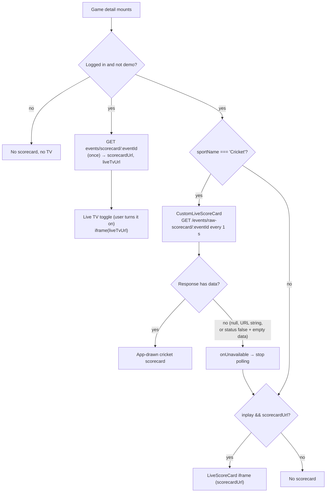

# Modules 5–7: Scorecard, Live TV and Raw scorecard (overview)

**Scope.** Three phase-1 modules documented together because they share one page area and two APIs:

| Module | What the user sees | API |
|---|---|---|
| 5 Scorecard | A third-party scorecard page in an iframe | [`GET events/scorecard/:eventId`](api-inventory.md#m1-getscorecard) → `scorecardUrl` |
| 6 Live TV | A third-party video stream in an iframe | **same call** → `liveTvUrl` |
| 7 Raw scorecard | A scorecard drawn by the app itself from JSON data (cricket only) | [`GET /events/raw-scorecard/:eventId`](api-inventory.md#m2-getlivescorecard), a **different** API, polled every 1 s |

So: Scorecard and Live TV come from one API call; the raw scorecard uses a separate API.

**Reference.** rsplay only: `rsplay/rsplay-user@810884b`, read at `HEAD`. Paths are relative to `src/`. Another implementation fetches the same two paths under different names and stores the URLs in Redux; it is not covered here.

**Files in this module**

| File | What it covers |
|---|---|
| this page | Where each piece appears, who can see it, the decision flow, findings |
| [scorecard-and-live-tv.md](scorecard-and-live-tv.md) | The URL call, the scorecard iframe, the Live TV toggles, per screen size |
| [raw-scorecard.md](raw-scorecard.md) | The app-drawn cricket scorecard: states, field mapping, fallback |
| [api-inventory.md](api-inventory.md) | Both APIs: request, response, consumers |
| [polling-and-frequency.md](polling-and-frequency.md) | 1 s raw-scorecard polling; URL call once per page |

---

## Where it appears

| Page | Route | Scorecard | Live TV | Raw scorecard |
|---|---|---|---|---|
| Game detail | `/sports/{cricket\|football\|tennis}/market-details/:eventId` (`App.tsx:71-84`) | Yes: fallback iframe, in-play only | Yes | Yes, cricket only |
| Race detail | `/details/:game/:eventId[/:gameId]` (`App.tsx:88-89`) | No | Yes, screens ≥ 1280 px only | No |

Both pages are public routes (not under `ProtectedRoute`), but all three features need a logged-in, non-demo user (below).

## Who sees what

`OBSERVED` from the skip rules and render conditions:

| User | Scorecard iframe | Live TV | Raw scorecard |
|---|---|---|---|
| Guest | No: `getScorecard` skipped (`useCatalogData.ts:27-29`) | No URL. The mobile toggle still shows but opens nothing (F5) | No: query skipped (`CustomLiveScoreCard.tsx:35-38`); renders nothing |
| Demo user | No: `getScorecard` skipped | No | No: `showCustomLiveScoreCard` is false for demo users (`GameDetails/index.tsx:60`) |
| Logged-in user | Yes, as described below | Yes, when `liveTvUrl` is present | Yes for cricket |

## Decision flow on the game detail page

Sources: `GameDetails/index.tsx:58-60,155-198,494-498`; `CustomLiveScoreCard.tsx:40-51`.

## Findings

All `OBSERVED` from source unless labelled.

| # | Finding | Where |
|---|---|---|
| F1 | **The raw scorecard uses only `getLiveScorecard` (1 s).** No second timer runs for the same URL (resolves Q-04) | `pages/GameDetails/components/CustomLiveScoreCard.tsx:35-38` |
| F2 | **Live TV has no control between 1024 and 1279 px wide.** The page's own toggle is `lg:hidden` (< 1024 px) and the side panel with the other toggle is `max-xl:hidden` (≥ 1280 px only). At laptop widths in between, there is no way to open the stream | `GameDetails/index.tsx:164-190`; `components/BettingContainer.tsx:44` (Tailwind default breakpoints; `tailwind.config.js` only sets `container.screens`) |
| F3 | **Race pages have Live TV only on wide screens.** `RacingInside` imports `Scorecard` but never renders it, so the only TV control is in `BettingContainer` (≥ 1280 px) | `pages/RacingInside/index.tsx:9,29-32,83` |
| F4 | **The scorecard is mounted twice.** The page renders a desktop copy (`hidden lg:block`) and a mobile copy (`lg:hidden`); CSS hides one but both are mounted. For the raw scorecard this is one shared 1 s poll (same cache entry, `INFERRED`). For the iframe fallback, the scorecard URL is **loaded twice** | `GameDetails/index.tsx:155-162,191-198` |
| F5 | **The mobile Live TV toggle is shown to guests and demo users** and to pre-match events, but it opens nothing when there is no `liveTvUrl`. There is no "not available" message | `GameDetails/index.tsx:164-190` |
| F6 | **URLs are fetched once and never refreshed.** `getScorecard` has no polling. If the backend returns no `liveTvUrl` before a match and one after it goes live, the user does not get it until the page is opened again after the 60 s cache window (`INFERRED`). Team (Q-31): intended. The URL opens a direct stream, so its content is live; turning Live TV off and on remounts the iframe and reloads the stream | `useCatalogData.ts:27-29` |
| F7 | **Live TV iframe has no `sandbox`**, while the scorecard iframe is sandboxed (`allow-scripts allow-same-origin allow-popups`). The stream page therefore runs with full iframe permissions (`INFERRED` risk; depends on the provider) | `GameDetails/index.tsx:188`; `BettingContainer.tsx:76`; `LiveScoreCard.tsx:28-33` |
| F8 | **The raw scorecard keeps polling every 1 s whatever the match state:** before the start, during, and after the result. It stops only when the API reports no data or the user leaves | `CustomLiveScoreCard.tsx:35-38,62-108` |
| F9 | **Once unavailable, never retried.** A single "no data" response switches the page to the iframe fallback for the rest of the visit | `GameDetails/index.tsx:59,157,193` |
| F10 | **`getScorecard` is typed `any`.** Only `scorecardUrl` and `liveTvUrl` are read; the rest of the response is unknown to the frontend | `eventsApi.ts:318` |
| F11 | **Dead props and code.** `BettingContainer` ignores `liveScoreUrl` and `isLive` and has unused `activeTab2` and `sharedIframe` import. `Scorecard.tsx` (tabs incl. "STARTS SOON") is not rendered anywhere. `GameDetails` resets `activeMobileTab` from `'livetv'` for guests, but no button sets `'livetv'` | `BettingContainer.tsx:7,22,27`; `GameDetails/index.tsx:128-132` |

Q-31 in [open-questions.md](../../../inventory/open-questions.md) is resolved (F6 is intended). Q-04 is resolved by F1.

**Data safety.** Scorecard and stream URLs are third-party links returned per event. They are never reproduced in these docs; examples use placeholders.
