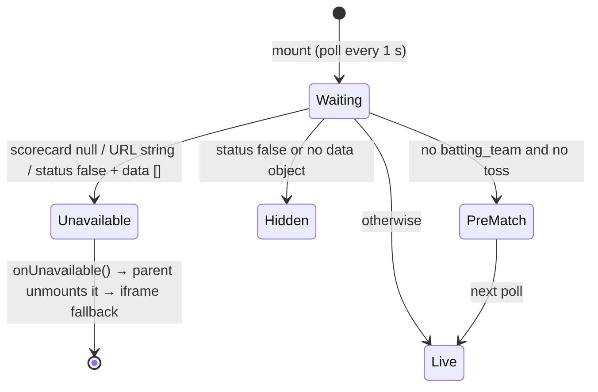

# Module 7 (Raw scorecard)

rsplay `@810884b`; paths relative to `src/`. Component `CustomLiveScoreCard` (`pages/GameDetails/components/CustomLiveScoreCard.tsx`). API: [M2 `getLiveScorecard`](api-inventory.md#m2-getlivescorecard), `GET /events/raw-scorecard/:eventId` every 1 s.

"Raw" means the API returns score **data** (JSON) and the app draws the card itself, unlike the [scorecard iframe](scorecard-and-live-tv.md#scorecard-iframe-module-5), which shows a provider's page.

## When it is used

`showCustomLiveScoreCard = sportName === 'Cricket' && !isDemoUser && !scorecardUnavailable` (`GameDetails/index.tsx:60`).

| Condition | Source |
|---|---|
| Route sport is Cricket (`/sports/cricket/market-details/:eventId`) | `App.tsx:36,79-82` |
| Not a demo user | `GameDetails/index.tsx:60` |
| Logged in (otherwise the query is skipped and the component renders nothing) | `CustomLiveScoreCard.tsx:35-38` |
| The API has not yet reported "no data" on this visit | `GameDetails/index.tsx:59` |

## States

| State | Rule | Shows | Source |
|---|---|---|---|
| Unavailable | `data` exists and (`!data.scorecard` or (`status === false` and `data` is an empty array)) | nothing; calls `onUnavailable()` once per change | `:40-51` |
| Hidden | `!data?.scorecard?.status` or `data` is not an object | nothing (polling continues) | `:53,60` |
| Pre-match | `!info.batting_team && !info.toss` | Team logos and short names either side; message `first_circle`, default "Match will start soon" | `:62-108` |
| Live | otherwise | full card (below) | `:110-327` |

A string response (the backend returning a scorecard URL instead of data) is turned into `scorecard: null` by `dropScorecardUrl`, so it counts as Unavailable (`eventsApi.ts:283-287`).

## Live card: field mapping

Derived values (`CustomLiveScoreCard.tsx:110-132`):

| Value | Rule |
|---|---|
| Batting side | `String(team_a_id) === String(batting_team)` → team A, else team B |
| Current innings | `battingScoreMap[current_inning]` (`team_a_score` or `team_b_score`) |
| Overs | `currentInnings.over`, default `'0'` |
| Previous innings | first key of the other team's score map that is not `team_id` |
| Bowler | `bolwer` (spelling as in the API) |

| Shown | Field(s) | Notes | Source |
|---|---|---|---|
| Batting team logo, "`<other short>` V" | `team_*_img`, `team_*_short` | broken images are hidden | `:140-161` |
| Score | `<short> score/wicket` | from current innings; `0/0` default | `:163-167` |
| Overs | `<over> OVER` | | `:168` |
| CRR | `curr_rate` | always | `:173` |
| RR | `rr_rate` | only when a previous innings exists | `:174` |
| Target | `target` | only with a previous innings and non-zero target; < 1280 px | `:176-180` |
| Batsmen | `batsman[]`: name as "F Surname", `run`, `ball`, strike marker when `strike_status` | `formatBatsmanName` removes a trailing `*` (`:14-19`) | `:186-202`, `:254-271` |
| Bowler | `bolwer.name`, `wicket-run`, `over` | hidden when name is `-` | `:205-214`, `:273-282` |
| Ticker | first of `result`, `need_run_ball` (2nd innings only), `toss` | scrolling `Marquee` | `:216-221`, `:284-289` |
| Other team | `team_*_scores` and `(team_*_over)`, else logo | | `:225-250` |
| Ball status | `first_circle`, shown as **"Ball Chalu"** when the value is `ball` | | `:54-58`, `:293-297` |
| Last 4 overs | `last4overs[]`: `<over>ov`, runs, each ball as a chip | chip colours: `W` red, `4` yellow, `6` green, others black (`getBallStyle`, `:21-30`) | `:300-326` |

Layout: batsmen, bowler and ticker sit in one row at ≥ 1280 px (`hidden xl:flex`) and in a two-column grid below the score at smaller widths (`xl:hidden`).

Fields in `LiveScorecardData` that are not shown: `match_id`, `series_id`, `match_type`, `second_circle`, `last_bolwer`, `balling_team`, `trail_lead`, `c_team_score`, `last36ball` (`eventsApi.ts:228-264`).
