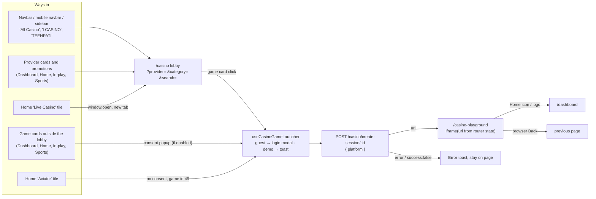

# Module 8: Casino (overview)

**Scope.** Casino gameplay: how users reach the casino, how the lobby works, and how a game is launched, opened and left.

**Reference.** vishnu7 only: `vishnu7/vishnu7user@6f3b811`, read at `HEAD`. Paths are relative to `src/`. The team chose this on 2026-11-19 because vishnu7 has a single casino lobby, which keeps the flow simple. Other implementations organise the lobby differently (for example, one route per provider) and are **not** covered here.

**Files in this module**

| File | What it covers |
|---|---|
| this page | The whole flow on one page, plus findings |
| [entry-points-and-redirects.md](entry-points-and-redirects.md) | Every link or button outside the lobby that leads into the casino, and what it passes |
| [lobby-and-filters.md](lobby-and-filters.md) | The `/casino` lobby: providers, categories, search, infinite scroll, URL parameters |
| [game-launch-flow.md](game-launch-flow.md) | Click → checks → consent → session → player → exit, step by step |
| [api-inventory.md](api-inventory.md) | Every casino API: request, response fields, consumer |
| [polling-and-frequency.md](polling-and-frequency.md) | When each casino API runs (there is no polling) |

Casino bet history is a report and is documented in [Module 4](../04-reports/casino-bet-history.md), from the other implementation.

---

## Routes

All casino routes sit inside `CasinoLayout`, which renders `Header`, `Marquee` and `Sidebar` around the page (`App.tsx:81-85`, `layouts/CasinoLayout.tsx`). None of the three is behind `ProtectedRoute`: guests can open them, and the login check happens at launch time.

| Route | Page | What it is |
|---|---|---|
| `/casino` | `pages/Casino/index.tsx` | The lobby: provider tabs, category tabs, search, game grid |
| `/casino-playground` | `pages/CasinoPlayground/index.tsx` | Full-screen game player (an iframe of the game URL) |
| `/casino-qtech` | `pages/QTECHLobby/index.tsx` | A provider lobby shown in an iframe. **No link points here**; it is only reachable by typing the URL |

## The flow in one picture

## Key behaviours

| Behaviour | Detail | Source |
|---|---|---|
| Who may launch | Guests (no `access-token` cookie) get the login modal. Demo users get the toast "Demo users are not allowed to play casino games.", **but see finding F2** | `hooks/useCasinoGameLauncher.ts:20-30` |
| Session request | `POST /casino/create-session/{gameId}` with body `{ platform: 'Mobile' \| 'Desktop' }`. The platform comes from the browser user agent | `useCasinoGameLauncher.ts:32-36`, `utils/index.ts:344` (`getPlatform`) |
| How the game opens | Inside the app, in an `<iframe>` on `/casino-playground`. The URL is passed in **router state** (`navigate('/casino-playground', { state: { gameUrl } })`) | `useCasinoGameLauncher.ts:38-44`, `pages/CasinoPlayground/index.tsx:7-10` |
| Only external navigation | The Home "Live Casino" tile opens the **lobby** (`/casino?provider=aura gaming`) in a new browser tab. No game is ever opened outside an iframe | `pages/Home/index.tsx:22-33` |
| Consent popup | "1 POINT = {value}" notice. On only when `VITE_SHOW_CASINO_MODAL === 'true'` **and** `VITE_CASINO_POINT_VALUE` is set. Whether production sets them is `NOT CONFIRMED FROM SOURCE` | `hooks/useCasinoConsentGate.ts:5-12` |
| Double-click protection | One launch at a time. A ref lock is held for at least 3 s, and the cards are disabled with a spinner on the clicked one | `hooks/useCasinoLobby.ts:123-139`, `hooks/useCasinoGamePlay.ts:16-33` |
| Leaving a game | No close button. The Home icon or logo goes to `/dashboard`; browser Back returns to the page the game was launched from | `CasinoPlayground/index.tsx:25-39` |
| Polling | None. Every casino API runs on mount, on a filter change or on a click | [polling-and-frequency.md](polling-and-frequency.md) |

---

## Findings

| # | Finding | Evidence | Label |
|---|---|---|---|
| F1 | The playground reads the game URL from router state only. Opening `/casino-playground` directly, in a new tab or from a bookmark shows "Invalid game URL". A reload of the same tab keeps the state (React Router restores `history.state`), so the game reloads with the **same session URL** | `CasinoPlayground/index.tsx:10-19` | `OBSERVED` (code); reload behaviour `INFERRED` |
| F2 | **Confirmed defect.** `useIsDemoUser` checks `role.name.toLowerCase() === ''` (empty string); the team confirmed it should be `'demo'`. As written, demo users are not detected and **can launch casino games** | `hooks/redux.ts:26-27` | `OBSERVED`; team confirmation 2026-11-19 (Q-23) |
| F3 | `createCasinoSession` returns `{ success, status, message, url? }`. If there is no `url` and `success` is not `false`, nothing happens: no game, no message | `useCasinoGameLauncher.ts:38-48` | `OBSERVED` |
| F4 | The Redux `casino` slice (`launchGame` / `closeGame`, `gameUrl`, `isOpen`) is written but the player never reads it. The lobby uses `gameUrl` only to scroll to the top and to skip the entry consent popup | `store/slices/casinoSlice.ts`, `useCasinoLobby.ts:17,177-181`, `pages/Casino/index.tsx:48-51` | `OBSERVED` |
| F5 | `launchCasinoGame(gameId, providerName)` ignores `providerName` (parameter `_providerName`). Callers pass `'mac88'`, a provider name or `'Aviator'`, and none of it is sent | `useCasinoGameLauncher.ts:18` | `OBSERVED` |
| F6 | Consent is not applied consistently. Dashboard/Home/In-play/Sports game cards ask per game. The lobby asks once on entering `/casino` (closing the popup sends the user to `/dashboard`) and its own cards launch without asking. The Home Aviator tile launches without asking | `useCasinoGamePlay.ts:36-40`, `useCasinoConsentGate.ts:52-82`, `Casino/index.tsx:48-51`, `useCasinoLobby.ts:131`, `Home/index.tsx:35-38` | `OBSERVED` |
| F7 | `/casino-qtech` calls `GET /casino/lobby/{userId}` with `Number(user.info?.id)` and no `skip`. Before the profile loads, or for a guest, this is `/casino/lobby/NaN` | `pages/QTECHLobby/index.tsx:6-7` | `OBSERVED`. Team-confirmed defect, deferred (Q-24) |
| F8 | The lobby lower-cases provider and category before sending them (`?provider=aura gaming`, `?category=slot games`), while the lists come from the API in their original case. **Intended:** the backend filters are case-sensitive and match lower-case values | `useCasinoLobby.ts:35-36,141-171` | `OBSERVED`; team confirmation 2026-11-19 (Q-25) |
| F9 | The sidebar contains code to launch games from an "Others" section (`handleOthersClick`), but that section is never rendered; only the sports tree is | `components/common/Sidebar.tsx:161-175,422` | `OBSERVED` |
| F10 | The `CasinoRound` TypeScript type for casino round history declares `user.meta.passwordHash`, `passwordSalt`, `mfaSecret` and `casinoToken`. The team-provided response has none of them (`user` is only `{ id, username }`), so this is a type leftover, not a leak | `store/api/casinoApi.ts:77-92` | Resolved (Q-26) |
