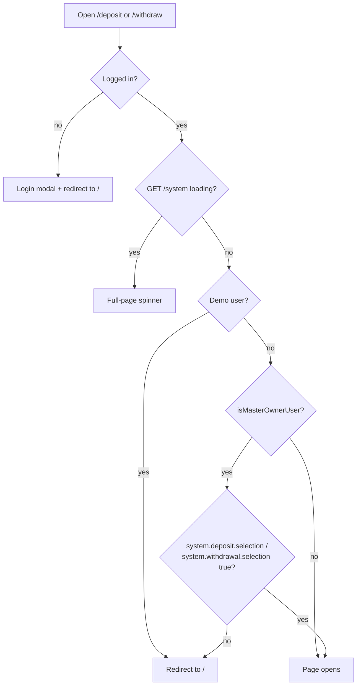

# Module 9: Deposit and Withdraw (overview)

**Scope.** The user's money-in and money-out pages: deposit by UPI, bank transfer or crypto; withdraw to a saved bank, UPI or crypto account; adding and deleting those accounts; and the deposit and withdraw request history. The Coins page (`/coins`) is not part of this module.

**Reference.** rsplay only: `rsplay/rsplay-user@810884b`, read at `HEAD`. Paths are relative to `src/`. The team chose this on 2026-11-19; the other implementation has no deposit or withdraw pages (see [feature coverage](../../../inventory/feature-coverage.md)).

**Files in this module**

| File | What it covers |
|---|---|
| this page | Routes, access rules, entry points, the request lifecycle, findings |
| [deposit.md](deposit.md) | Method selection, UPI and bank deposit, crypto deposit with rate conversion, deposit history |
| [withdraw.md](withdraw.md) | Saved accounts, adding and deleting accounts, the withdrawable-balance rule, bank/UPI and crypto withdraw, withdraw history |
| [api-inventory.md](api-inventory.md) | Every API used here: request, response fields, cache tags, consumers; unused duplicates listed |
| [polling-and-frequency.md](polling-and-frequency.md) | When each request runs; the layout polls that feed these pages |

---

## Routes

| Route | Page | Guards | Source |
|---|---|---|---|
| `/deposit` (optional `?type=upi\|bank\|crypto`) | `pages/Deposit/index.tsx` (`DepositPage`) | `ProtectedRoute` → `FeatureRoute feature="deposit"` | `App.tsx:92,108-115`; lazy: `routes/index.tsx:25` |
| `/withdraw` | `pages/Withdraw/index.tsx` (`WithdrawPage`) | `ProtectedRoute` → `FeatureRoute feature="withdrawal"` | `App.tsx:92,116-123`; lazy: `routes/index.tsx:26` |

## Who can open these pages

`OBSERVED`, `components/common/FeatureRoute.tsx:11-38` (`FeatureRoute`) and `components/common/ProtectedRoute.tsx:7-31` (`ProtectedRoute`):

| User | Deposit / Withdraw |
|---|---|
| Guest | Login modal, redirect to `/` |
| Demo user (`role.name` is `demo`) | Redirect to `/`; links hidden |
| User under a master owner (`isMasterOwnerUser` true) | Allowed only when the system setting `deposit.selection` / `withdrawal.selection` is true |
| Any other logged-in user | Always allowed; the system setting is not checked |

`isMasterOwnerUser` comes from `GET /users/is/master-owner/user` (`store/api/userApi.ts:61`, stored by `store/slices/userSlice.ts:41-43`). The system settings come from `GET /system` (`store/api/systemApi.ts:27-34`). **Team-confirmed intent (2026-11-19, Q-33):** the settings apply only to users under a master owner.

## Entry points

The same visibility rule (logged in, not demo, and the setting check above) hides every link (`OBSERVED`):

| Place | Source |
|---|---|
| Header deposit / withdraw buttons | `components/Header.tsx:139-155` |
| Profile drawer | `components/ProfileDrawer.tsx:168-195` |
| Sidebar | `components/Sidebar.tsx:390-418` |
| Home page buttons (`showDeposit`, `showWithdraw`) | `pages/Home/index.tsx:28-50` |

## Request lifecycle

Deposits and withdrawals are **requests**, not instant transfers. The frontend only creates a request; an admin approves or rejects it (`INFERRED` from the history statuses and the withdraw rule "subject to the approval of the admin", `public/locales/en/common.json` `withdraw.rules.items[0]`).

| Status (`DepositWithdrawItem.status`) | Badge colour | Source |
|---|---|---|
| `Approved`, `Confirmed` | green | `DepositHistorySection.tsx:36-44`, `WithdrawHistorySection.tsx:42-50` (`getStatusClass`) |
| `Rejected`, `Failed` | red | same |
| `Pending` and anything else | amber | same |

`type: 'Credit'` is a deposit and `type: 'Debit'` a withdrawal, both in the request body and in the history filter (`types/account.ts:73-81,83-105`).

## Units and calculations (summary)

| Rule | Value | Source |
|---|---|---|
| UPI / bank deposit amount | INR, at least 100 and inside the selected account's min/max | `utils/validations.ts:185`; `DepositMethodSection.tsx:245-259` |
| Crypto deposit `amount` | **USDT quantity** (whole numbers). INR shown as `USDT × usdRate`. Team-confirmed (Q-32) | `CryptoDeposit.tsx:28-37`; `CryptoRateConvertor.tsx:50-58` |
| Withdrawable balance | `mainBalance − lockedAmount + exposure`. `exposure` is ≤ 0, so this is main − locked − \|exposure\|. Team-confirmed (Q-34) | `pages/Withdraw/components/AccountCard.tsx:28-31`; `pages/Withdraw/CryptoAccountList.tsx:9-11` |
| Bank / UPI withdraw | INR, 100 to withdrawable | `AccountCard.tsx:30-31` |
| Crypto withdraw `amount` | **INR**, 1 to withdrawable. Team-confirmed (Q-32) | `CryptoAccountList.tsx:22-23`; `CryptoWithdrawForm.tsx:74-80` |

Details: [deposit.md](deposit.md#crypto-deposit), [withdraw.md](withdraw.md#withdrawable-balance).

## Findings

All `OBSERVED` from source unless labelled.

| # | Finding | Where |
|---|---|---|
| F1 | **Two sets of API definitions for the same URLs.** `store/api/accountApi.ts` and `store/api/depositApi.ts` / `withdrawApi.ts` both define `GET /banker/show-account`, `GET /bank`, `GET /banker/my-deposit-withdraw`, `POST /bank` and deposit-withdraw requests under different names and tags. 10 endpoints in `depositApi.ts` / `withdrawApi.ts` are never called. Only the definitions in use are documented (Q-01 rule); the unused ones are listed in the [API inventory](api-inventory.md#unused-definitions) | `store/api/accountApi.ts`, `depositApi.ts`, `withdrawApi.ts` |
| F2 | **Crypto deposit checks only the minimum.** The schema requires `fiat ≥ min` but has no maximum, although the card says "Deposit between min and max". Team-confirmed: a maximum check will be added (Q-35; listed under confirmed frontend fixes) | `utils/validations.ts:233-245`; `CryptoRateDisplay.tsx:68-72` |
| F3 | **Crypto deposit quick buttons add USDT, not INR.** `+500` … `+100,000` add that many USDT to the crypto field (INR = USDT × rate), the same values the INR deposit form uses. Team-confirmed intended (Q-36) | `pages/Deposit/components/Form.tsx:74-79,332-355` |
| F4 | **Crypto withdraw amount shows a USDT icon** but the value is INR (team-confirmed unit) and is checked against the INR balance with a minimum of 1, not 100 as for bank/UPI | `CryptoWithdrawForm.tsx:177-185`; `CryptoAccountList.tsx:22-23` |
| F5 | **The converter on the crypto withdraw card is display only.** Its USDT and INR values are not sent; the request carries only `amount` and `cryptoId` | `CryptoWithdrawForm.tsx:74-80,147-171` |
| F6 | **Accounts are deleted on one click**, with no confirmation, for bank, UPI and crypto | `AccountCard.tsx:59-70,79`; `CryptoWithdrawForm.tsx:63-72,100` |
| F7 | **Null account limits would block deposits, but cannot occur.** `Number(null ?? 0)` is `0`, so a null min/max would make the range check `0 ≤ amount ≤ 0`. Team-confirmed (Q-37): min and max are mandatory on every deposit account, so the backend never returns null limits | `DepositMethodSection.tsx:245-259` |
| F8 | **Bank/UPI proof is uploaded at submit time.** If `POST …/deposit-withdraw-request` then fails, the uploaded file is not reused; the next attempt uploads again (`INFERRED`: orphan files on the server). Crypto deposit uploads as soon as a file is chosen | `DepositMethodSection.tsx:261-273`; `Form.tsx:93-125` |
| F9 | **Every upload refetches the account lists and history.** `uploadFile` invalidates `Account`, which `getDepositAccounts`, `getBankAccount`, `getUpiAccount` and `getDepositWithdraw` provide | `store/api/accountApi.ts:77-96` |
| F10 | **`/deposit?type=bank` with no bank accounts renders an empty section** (no message), because the bank branch needs `activeBank` and otherwise falls through to `return null` | `DepositMethodSection.tsx:344,391` |
| F11 | **The withdrawable figure updates only with the 5 s wallet poll.** The withdraw mutation invalidates `Account` and `User`, but `getUserWallets` has no tags, so the max may lag by up to 5 s after a request (`INFERRED`) | `AccountCard.tsx:28`; `components/Header.tsx:57-60`; `store/api/userApi.ts:47-52` |
| F12 | **Proof rules differ by method.** UPI/bank: required, image or PDF, ≤ 5 MB. Crypto deposit: optional, JPEG/PNG/WebP only, ≤ 5 MB | `DepositForm.tsx:76-88`; `utils/validations.ts:187-189,244`; `Form.tsx:98-113` |
| F13 | **Dead code.** `CryptoWalletModal.tsx` is imported nowhere. The `Crypto:` field in `handleDepositSubmit` is unreachable (crypto uses `CryptoDeposit`). The converter's swap button has its `onClick` commented out. `Form.tsx` has a non-crypto (`wallet`) branch but is only rendered with `type="crypto"` | `pages/Withdraw/CryptoWalletModal.tsx`; `DepositMethodSection.tsx:272,383-389`; `CryptoRateConvertor.tsx:105-115`; `CryptoDeposit.tsx:94-104` |

Team answers recorded on 2026-11-19: Q-32 to Q-37 in [open-questions.md](../../../inventory/open-questions.md). No open questions remain for this module.

**Data safety.** Account numbers, UPI IDs, wallet addresses, QR images and proof images are user or payment data. They are never reproduced in these docs; examples use placeholders.
