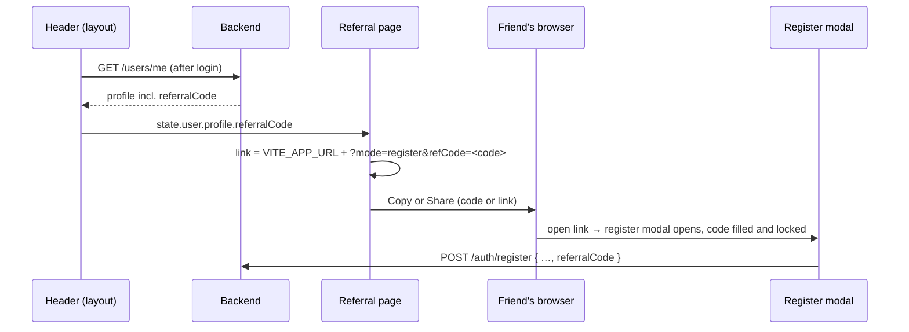

# Module 10: Referrals (overview)

**Scope.** The **Referral** page at `/referral`, where a logged-in user copies or shares a personal referral code and link. Also covers the other side: how a shared link opens the register form with the code filled in, and how the code is sent at sign-up. The bonus a referral earns appears in the Bonus Statement under the `ReferralBonus` category ([Module 11](../11-bonuses/overview.md)).

**Reference.** rsplay only: `rsplay/rsplay-user@7a89e53`, read at `HEAD`. Paths are relative to `src/` unless they start with `public/`. The team chose this commit on 2026-11-25. None of the files in this module changed between `810884b` (the commit Modules 1–9 cite) and `7a89e53`.

**Files in this module**

| File | What it covers |
|---|---|
| this page | Route, access, the referral page, the shared link, sign-up with a code, findings |
| [api-inventory.md](api-inventory.md) | The requests this module depends on. It has none of its own |
| [polling-and-frequency.md](polling-and-frequency.md) | When those requests run (nothing polls) |

---

## Route and access

| Item | Rule | Source |
|---|---|---|
| Route | `/referral`, lazy-loaded, inside `HomeLayout` and `ProtectedRoute` | `App.tsx:59,92,105` (`App`); `routes/index.tsx:27` (`ReferralPage`) |
| Guest | `ProtectedRoute` opens the login modal and redirects to `/` | `components/common/ProtectedRoute.tsx:12-28` (`ProtectedRoute`) |
| Menu entry | Profile drawer item 13 "Referral" (`/referral`) | `utils/constants.ts:374-379` (`profileDrawerItems`); `components/ProfileDrawer.tsx:34` (`profileDrawerItemI18nKey`) |
| Demo user | The drawer shows demo users only item 7 (Rules), so they have no menu link. If a demo user opens `/referral` directly, the page shows "Referral program is not available for demo accounts." | `ProfileDrawer.tsx:208-210`; `pages/Referral/index.tsx:53-56` (`Referral`); `hooks/redux.ts:22-23` (`useIsDemoUser`, `role.name` is `demo`) |

The old sidebar menu that also listed Referral is commented out (`utils/constants.ts:262-276`, `privateMenu`).

## How it works

## The Referral page

`pages/Referral/index.tsx` (`Referral`). The page makes **no API request**. Everything comes from the profile already in Redux and one build-time setting.

| Item | Value | Source |
|---|---|---|
| Referral code | `state.user.profile.referralCode`, or `''` when missing. The profile is filled by `GET /users/me`, which the header requests after login ([R1](api-inventory.md#r1-getuserprofile-get-usersme)) | `index.tsx:14`; `store/slices/userSlice.ts:38-40`; `components/Header.tsx:54` |
| Referral link | `` `${VITE_APP_URL}?mode=register&refCode=${referralCode}` `` when both the code and `VITE_APP_URL` exist, otherwise `''` | `index.tsx:10,18-19` |
| Display | Two cards, "Your Referral Code" and "Your Referral Link". An empty value shows `-` | `index.tsx:60-72`; `ShareCard` at `:80-120` |

`VITE_APP_URL` is environment configuration; its value is not recorded here.

### Copy

`handleCopy` (`index.tsx:21-25`) returns at once when the value is empty. Otherwise it calls `useClipboard().copy` (`hooks/useClipboard.ts:17-52`), which uses `navigator.clipboard.writeText` on a secure page and a hidden `<textarea>` with `document.execCommand('copy')` otherwise (`utils/index.ts:59-82`, `copyToClipboard`). On success it shows a toast: "Referral code copied to clipboard!" or "Referral link copied to clipboard!".

### Share

`handleShare` (`index.tsx:36-47`) builds a message from the translation keys `referral.shareMessage.*` (`buildShareMessage`, `:27-34`; `public/locales/en/common.json:833-837`): a fixed promotional paragraph, then one line with the code or the link.

| Browser | What happens |
|---|---|
| Has `navigator.share` (most phones) | Opens the system share sheet with the message as `text` only (no `url` field). A cancelled share is ignored (`.catch(() => {})`) |
| No `navigator.share` (most desktops) | Copies the **whole message** to the clipboard. The toast still says "Referral code copied" or "Referral link copied" |

The promotional paragraph, including the brand name, is part of the translation text in every language file, not configuration ([F5](#findings)).

## Opening a referral link

`hooks/useReferralRegisterModal.ts:16-34` (`useReferralRegisterModal`), called once in `App` (`App.tsx:42`). It runs **once, on the first load of the app** (empty dependency list):

| Visitor | `?mode=register` present | Result |
|---|---|---|
| Not logged in | yes | Opens the register modal (`openModal({ name: 'register' })` → `SignupModal`, `components/ModalManager.tsx:19`) |
| Logged in | yes | Removes `mode` and `refCode` from the address bar (`replace: true`); no modal |
| Any | no | Nothing |

"Logged in" here is the start-up value of `isAuthenticated`: `true` when a stored access token has not expired (`store/slices/authSlice.ts:28-40`). The link opens on the route in `VITE_APP_URL`; with no path that is `/`, the Home page.

`?mode=register` alone, with no `refCode`, also opens the register modal (`OBSERVED`: only `mode` is checked, `:21`).

## Signing up with a code

| Step | Rule | Source |
|---|---|---|
| Read the code | `useRegister` reads `refCode` from the current URL | `pages/Auth/hooks/useRegister.ts:22-23` (`useRegister`) |
| Fill it in | When `refCode` exists, `setValue('referralCode', refCode, { shouldValidate: true })` | `useRegister.ts:59-63` |
| Lock it | The "Referral Code" field is disabled while `refCode` exists in the URL, so the visitor cannot change it | `components/SignupModal.tsx:36,211-221` (`SignupModal`) |
| Typed by hand | Without a link, the field is empty and editable | `useRegister.ts:46-55` (default `referralCode: ''`) |
| Validation | `z.string().optional()`: no format or length check in the browser | `utils/validations.ts:127` (`registerSchema`) |
| Sent | `referralCode: data.referralCode` in the `POST /auth/register` body, **always**, as `""` when blank | `useRegister.ts:87-99` (`handleSubmitForm`); request in [Login and Signup](../authentication/api-inventory.md#post-authregister) |

Whether the backend accepts an empty string, and what it does with an unknown code, is `BACKEND CONFIRMATION REQUIRED` (Q-60).

## What the page does not show

`OBSERVED` (search at HEAD): the user app has no request or page for referred users, referral counts or referral earnings. The only referral reward the user sees is a bonus row with category `ReferralBonus` in the Bonus Statement ([Module 11](../11-bonuses/overview.md)). How and when that bonus is granted is a backend rule and is not documented here (Q-61).

**Not part of referrals:** `getUserReference` (`GET /users/reference/user`, `store/api/userApi.ts:54-59`) only looks related by name. Its `reference` value is the P&L figure in the profile drawer (`ProfileDrawer.tsx:64-67`, `totalPL`).

## Findings

All `OBSERVED` from source unless labelled.

| # | Finding | Where |
|---|---|---|
| F1 | **The page has no API of its own.** If the profile has not loaded yet, or has no `referralCode`, both cards show `-` and Copy and Share do nothing, with no message | `index.tsx:14,18-25,36-37` |
| F2 | **The link depends on `VITE_APP_URL`.** If it is not set for an environment, the link card shows `-` while the code card still works | `index.tsx:10,18-19` |
| F3 | The code is put into the link as is, without `encodeURIComponent`. This is only safe while codes use URL-safe characters (`INFERRED`; the code format is not defined in the frontend) | `index.tsx:19` |
| F4 | **Desktop "Share" copies the full promotional message**, but the toast says the code or link was copied | `index.tsx:36-47` |
| F5 | The share message, with the brand name and marketing lines, is hard-coded in each language file, so changing it for a platform means editing every locale | `public/locales/*/common.json` (`referral.shareMessage`) |
| F6 | **A link opens the register modal only on the first load of the app.** If a logged-in visitor opens it, the code is dropped from the URL. Nothing tells them the link is for new accounts | `useReferralRegisterModal.ts:21-33` |
| F7 | `?mode=register` without `refCode` also opens the register modal | `useReferralRegisterModal.ts:21` |
| F8 | **An empty code is sent as `""`**, not left out. The other implementation sends `referralCode` only when it is non-empty ([Login and Signup › contract table](../authentication/api-inventory.md#backend-contract-team-provided-2026-11-19-q-21)) | `useRegister.ts:50,97` (Q-60) |
| F9 | No browser check of the code. A wrong code is only reported if the register request fails | `validations.ts:127` |
| F10 | Demo users can open the page by typing the URL; they get a message instead of a redirect | `index.tsx:53-56` |

Questions raised: Q-60, Q-61 in [open-questions.md](../../../inventory/open-questions.md).
