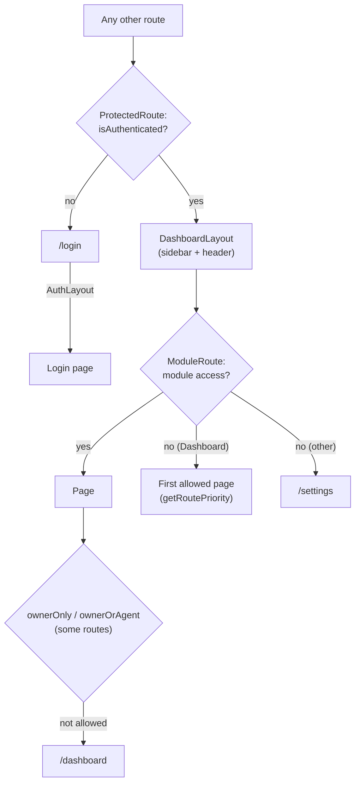
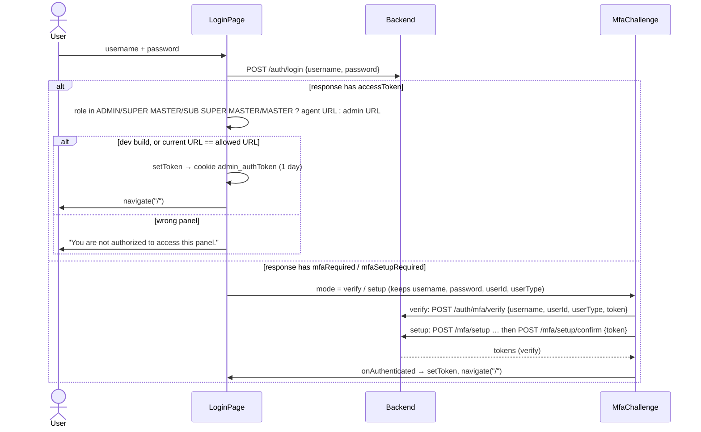

# Admin Module A1: Login and layout shell (overview)

**Scope.** This module covers the login page, MFA (multi-factor authentication) at login, the "Login as" hand-off to the agent panel, session storage and expiry, and route guards. It also covers the layout that wraps every page after login: the header with notifications, the MFA switch and balance, the forced password change, logout, and the sidebar. The sidebar has its own page: [sidebar.md](sidebar.md).

**Reference.** `rsplay/rsplay-admin@12f0054`, paths relative to `src/`. See the [phase overview](../overview.md) for roles and the API client.

| File | What it covers |
|---|---|
| this page | Login, MFA, "Login as", session, guards, header, findings |
| [sidebar.md](sidebar.md) | Which menu each account type sees and how it behaves |
| [api-inventory.md](api-inventory.md) | Every API in this module: request, response fields, consumer |
| [polling-and-frequency.md](polling-and-frequency.md) | What repeats on every page and why |

---

## Routes and guards

| Guard | Rule | Source |
|---|---|---|
| `AuthLayout` (wraps `/login`) | Already logged in → `/dashboard`. Also handles the "Login as" code (below) | `layouts/AuthLayout.tsx:61-71` |
| `ProtectedRoute` | `auth.isAuthenticated` false → `/login` with `state.from` | `components/common/ProtectedRoute.tsx:4-21` |
| `ModuleRoute` | Owner and agents always pass. Role users need every listed access type (default `read`) on the module key. On failure: for `Dashboard`, go to the first module the user can read (`getRoutePriority`), otherwise `/settings`. It shows a loader until the `USER` role id is known | `components/ModuleRoute.tsx:16-70` |
| `ownerOnly(...)` | Owner or role user, else `/dashboard` | `App.tsx:92-96`; `components/routes/ProtectedAdminRoutes.tsx:3-16` |
| `ownerOrAgent(...)` | Owner, role user or agent, else `/dashboard` | `App.tsx:98-105` |
| `/transaction-code` | Outside `ProtectedRoute` and the layout | `App.tsx:372` |
| `*` | `NotFoundPage` | `App.tsx:375` |

`isAuthenticated` is only "a cookie exists". It is set from `Cookies.get('admin_authToken')` at start-up (`store/slices/authSlice.ts:13-23`). An expired token is detected only when an API call returns 401 (see [session](#session-and-logout)).

## Login

### Form

| Field | Label | Validation (`utils/validation.tsx:20-24 (loginSchema)`) |
|---|---|---|
| `username` | "Username" if `VITE_AGENT_URL` is set, else "Email" (`pages/auth/LoginPage.tsx:184-185`) | trimmed, at least 3 characters |
| `password` | "Password" | at least 1 character |

The schema has a commented-out `captcha` field. `getCaptcha` (`POST /captcha`) is defined but not called anywhere, and `components/common/Captcha.tsx` is not imported anywhere (`OBSERVED`, search at HEAD).

### Flow

| Step | Detail | Source |
|---|---|---|
| Request | `POST /auth/login` with `{ username, password }` only. No device or captcha is sent | `LoginPage.tsx:61-67`; [L1](api-inventory.md#l1-login) |
| Choosing the panel | `isAgentRole(res.role.name)` → `VITE_AGENT_URL`, else `VITE_ADMIN_URL` | `LoginPage.tsx:19-24,69` |
| Panel check | Skipped when `import.meta.env.PROD` is false. In production, `window.location.origin + pathname` must equal the allowed URL exactly | `LoginPage.tsx:50-51,71` |
| Success | `setToken(res.accessToken)` (Redux + cookie), then `navigate('/')`. The refresh token in the response is ignored | `LoginPage.tsx:72-73`; `authSlice.ts:39-52` |
| MFA needed | Response with `mfaRequired` → verify; `mfaSetupRequired` → setup. `mfaMethod` chooses the visible method | `LoginPage.tsx:31-33,89-99` |
| Error text | Toast by message keyword: "captcha" → "Invalid captcha, please try again."; "password" → "Incorrect password, please try again."; "user" → "User does not exist."; else the backend message. The banner above the form shows the raw backend message | `LoginPage.tsx:100-113,116` |
| Wrong-panel text | "You are not authorized to access this panel." (banner) | `LoginPage.tsx:84-85` |

The success branch logs the whole login response, including the access token, with `console.log(res)` (`LoginPage.tsx:70`). See F1.

### MFA at login (`features/mfa/MfaChallenge.tsx`)

Only Google Authenticator (TOTP) is active. Telegram MFA is commented out in the API file and both MFA components ("Telegram MFA hidden for now", `store/api/authApi.ts:88-109`).

| Mode | What the user does | Requests | Source |
|---|---|---|---|
| `verify` | Enters the 6-digit code (non-digits are stripped; the code must match `^\d{6}$`) | `POST /auth/mfa/verify` `{ username, userId, userType, token }` → `{ accessToken, refreshToken?, type }` | `MfaChallenge.tsx:87-108`; [L4](api-inventory.md#l4-verifymfa) |
| `setup` | Chooses Google Authenticator. The QR code and manual key are shown, then the user confirms with a 6-digit code | `POST /mfa/setup` `{ usernameOrEmail, password, status: 'ACTIVE' }` → `{ qrCode, secret }`; then `POST /mfa/setup/confirm` `{ token }` | `MfaChallenge.tsx:69-85,95-99`; [L2](api-inventory.md#l2-setupmfa), [L3](api-inventory.md#l3-confirmmfasetup) |

After a successful **setup** confirmation the screen shows "Google Authenticator has been enabled." and stays on the MFA screen. It does not log the user in. The user must press "Back to login" and sign in again, which then goes through `verify` (`MfaChallenge.tsx:95-98`, `OBSERVED`).

### "Login as" (Owner opens an agent session)

| Step | Where | Source |
|---|---|---|
| 1. Owner presses **Login As** on an agent row in Downline | Admin panel | `pages/Downline/AllDownlineListing.tsx:524-557` |
| 2. `GET /auth/gettoken/{userId}` returns a one-time code (raw text, a JSON string or `{code|token}`; all are normalised to `{ code }`) | Admin panel | `store/api/authApi.ts:190-211`; [L11](api-inventory.md#l11-getloginastoken) |
| 3. A new tab opens `VITE_AGENT_URL?code=<code>` (`noopener,noreferrer`) | Browser | `AllDownlineListing.tsx:125-143 (handleLoginAs)` |
| 4. On the agent panel, `AuthLayout` sees `code` and calls `GET /auth/verify-token/{code}` **without** an auth header | Agent panel | `layouts/AuthLayout.tsx:32-59`; `apiSlice.ts:12-14`; [L12](api-inventory.md#l12-verifylogintoken) |
| 5. `accessToken` → `setToken`, then `/`. This replaces any session already open in that browser | Agent panel | `AuthLayout.tsx:47-49` |
| Guard | A `code` on the **admin** URL is rejected: toast "Login links are only valid on the agent panel." and the code is removed from the URL | `AuthLayout.tsx:20-37` |

`exchangedCode` (a ref) stops the same code being exchanged twice when React StrictMode runs effects twice (`AuthLayout.tsx:18,39-40`).

## Session and logout

| Event | What happens | Source |
|---|---|---|
| App start | Token read from the `admin_authToken` cookie. If present, `isAuthenticated = true` | `authSlice.ts:13-23` |
| Login | Cookie set for 1 day | `authSlice.ts:47-51` |
| Any API returns 401 | Cookie and `dwRequestAutoRefresh` local-storage flag removed. 2 s later, `window.location.href = '/login'` | `store/api/apiSlice.ts:23-35` |
| `/users/me` returns status `inactive` or `suspended` | Logout with a status message (for example "Your account has been suspended. You have been logged out."), then `/login` | `layouts/DashboardLayout.tsx:39,111-136`; `utils/constent.ts:284-288` |
| Sidebar **Logout** | `POST /auth/logout`, clear auth and user, remove the D/W auto-refresh flag, toast, full reload to `/login`. If the logout call fails, only an error toast is shown and the user stays logged in | `components/common/EnhancedSidebar.tsx:681-693` |
| MFA enabled from the header | Logout (errors ignored), clear state, then `/login` | `DashboardLayout.tsx:139-151` |

`bet_lock` has a logout message in `STATUS_LOGOUT_MESSAGES` but is not in `BLOCKED_STATUSES`, so a bet-locked account stays logged in (F6).

## Layout (`layouts/DashboardLayout.tsx`)

Every page after login renders inside this layout: the sidebar on the left, a sticky header, and the page in `<main>`.

| Part | Behaviour | Data | Source |
|---|---|---|---|
| Menu button | Opens and closes the sidebar. Starts open on screens at least 768 px wide | — | `DashboardLayout.tsx:42-43,174-181` |
| Notification bell | Badge with the unread count (`99+` above 99). When the count goes **up** (not on first load): plays `/images/notification.mp3`, the bell shakes for 3 s, and a "new notification" banner appears | `GET /push-notification/unread` every **10 s** | `DashboardLayout.tsx:30-35,56-92,184-195`; [L14](api-inventory.md#l14-getunreadnotifications) |
| Notification panel | Right-hand drawer. Opening it loads the latest 20 and marks **all** as read once per opening. Clicking an item goes to `/requests/{type}/{qr|banks|crypto}` (Deposit/Withdraw requests) | `GET /push-notification` (`page=1, limit=20`), `POST /push-notification/read` | `components/common/NotificationSidebar.tsx:17-51`; [L15](api-inventory.md#l15-getnotifications), [L16](api-inventory.md#l16-markallread) |
| MFA switch | **Owner only.** Shows `isMfaEnabled`. Turning it on opens the setup dialog (username or email + password → QR → code). After success the user is logged out to sign in with MFA. Turning it off asks for a code and calls `POST /mfa/setup` with `status: 'INACTIVE'` | `GET /mfa/status` | `DashboardLayout.tsx:51-55,197-211,256-264`; `features/mfa/MfaSettingsModal.tsx:150-232`; [L5](api-inventory.md#l5-getmfastatus) |
| Name and balance | Name: role user → email; Owner → "OWNER"; others → username. Balance: `amount` of the wallet with `type === 'Main'` | `GET /users/me/wallets` every **20 s** | `DashboardLayout.tsx:100,106-108,137,213-221`; [L10](api-inventory.md#l10-getwallet) |
| Forced password change | If `user.passwordChanged === false`, a "Create Password" modal opens over every page until the user closes it. Submit: Owner and role users → `POST /admin/change-password`; agents → `POST /users/me/change-password`. Success **or** Cancel logs the user out | `/users/me` (below) | `DashboardLayout.tsx:102-103,109,230-243`; `components/common/ChangePassword.tsx:64-105`; [L8](api-inventory.md#l8-changepassword--ownerchangepassword) |
| Current user | `/users/me` → Redux `user` slice (role, username, partnership, `passwordChanged`, status). Read by every role check | `GET /users/me` every **20 s** | `DashboardLayout.tsx:94-97`; `store/api/authApi.ts:128-140`; [L6](api-inventory.md#l6-getuser) |
| Role ids | `GET /role/available` → Redux `roles` slice, used to build `/members/{roleId}` links | once per layout mount | `DashboardLayout.tsx:99`; [L7](api-inventory.md#l7-availbleroles) |

`useRoleCheck` subscribes to the same `/users/me` cache entry. Until that first response arrives, `isOwner`, `isDownlineUser` and `isRoleUser` are all `false` (`hooks/useRoleCheck.ts:14-37`). Routes wrapped in `ownerOnly` show a loader while this is pending (`App.tsx:92-96`).

## Findings

All `OBSERVED` from source unless labelled.

| # | Finding | Where |
|---|---|---|
| F1 | **The login response, including the access token, is written to the browser console** (`console.log(res)`) on every successful password login | `pages/auth/LoginPage.tsx:70` (Q-39; **team-confirmed defect**: remove the log) |
| F2 | **There is no token refresh.** The refresh token is ignored. A 401 from any call clears the cookie and sends the user to `/login` after 2 s | `store/api/apiSlice.ts:23-35` |
| F3 | **"Authenticated" means "a cookie exists".** The app shows protected pages until the first API call returns 401 | `store/slices/authSlice.ts:13-23` |
| F4 | **The panel check runs only in production builds** (`import.meta.env.PROD`). In development any role can log in on either URL | `LoginPage.tsx:71` |
| F5 | **The username label depends on whether `VITE_AGENT_URL` is configured, not on which panel is open.** When it is set, both panels say "Username" | `LoginPage.tsx:184-185` |
| F6 | **`bet_lock` does not log the user out.** A message exists for it, but only `inactive` and `suspended` are acted on | `layouts/DashboardLayout.tsx:39,111-123`; `utils/constent.ts:284-288` (Q-49; **team-confirmed intent**: the sign-out on `inactive`/`suspended` stops a blocked agent immediately; `bet_lock` keeps the session) |
| F7 | **`apiSlice.util.resetApiState()` is called without `dispatch` on two logout paths**, so it does nothing there. The full-page reload to `/login` clears state anyway | `components/common/EnhancedSidebar.tsx:687`; `layouts/DashboardLayout.tsx:129`; `components/common/ChangePassword.tsx:85,99` |
| F8 | **After MFA setup at login the user is not logged in.** They must go back and sign in again | `features/mfa/MfaChallenge.tsx:95-98` |
| F9 | **The forced "Create Password" modal can be closed only by changing the password or cancelling; both end in logout.** Closing is via `userClosed`, which `ChangePassword` sets only after logout | `DashboardLayout.tsx:102-109,236-241` |
| F10 | **Dead code:** `getCaptcha`, `components/common/Captcha.tsx`, `refreshKey` state on the login page (incremented, never read), the commented transaction-code flow, and Telegram MFA | `authApi.ts:115-120`; `LoginPage.tsx:37,102,75-82` |

Questions raised: Q-39 (confirmed defect) and Q-49 (intended), both resolved 2026-11-24 in [open-questions.md](../../../inventory/open-questions.md).
