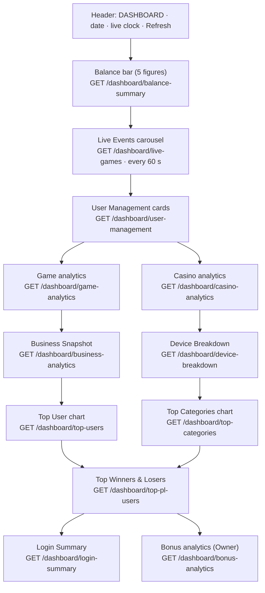

# Admin Module A2: Dashboard (overview)

**Scope.** The `/` and `/dashboard` page (`pages/dashboard/DashboardPage.tsx`). It covers the balance bar, Live Events, User Management, Game and Casino analytics, Business Snapshot, Device Breakdown, Top User, Top Categories, Top Winners and Losers, Login Summary, and Bonus analytics.

**Reference.** `rsplay/rsplay-admin@12f0054`, paths relative to `src/`. The same page serves the Owner, agents and role users. What each sees is listed under [visibility](#who-sees-what).

| File | What it covers |
|---|---|
| this page | Page layout, each section's fields and rules, filters, refresh, findings |
| [api-inventory.md](api-inventory.md) | The 14 requests the page makes: parameters, response fields, consumer |
| [polling-and-frequency.md](polling-and-frequency.md) | What runs on open, on filter change and on a timer |

---

## Route and access

| Route | Guard | Source |
|---|---|---|
| `/` and `/dashboard` | `ModuleRoute moduleName="Dashboard"`. A role user without `Dashboard.read` is sent to the first page they can read (`getRoutePriority`), or `/settings` | `App.tsx:118-133`; `components/ModuleRoute.tsx:16-36,53-60` |

## Page layout

Every section has its **own** date filter and its own request. Changing one section's filter refetches only that section.

## Date filters (shared pattern)

Each card has a `DropdownWithDate` with the options **Last 7 Days**, **Today** and **CustomRange** (`components/common/DropdownWithDate.tsx:19-127`). The dropdown starts on its first option, "Last 7 Days" (`:29`).

| Choice | Range sent | Source |
|---|---|---|
| (page open) / Last 7 Days | start of (today − 6 days) … end of today | `utils/helper.ts:242-257 (resolveDateRange)` with `defaultDays: 6`; `DashboardPage.tsx:376-382` |
| Today | start of today … end of today | `resolveDateRange` rounds both ends (`helper.ts:245-251`) |
| CustomRange | start of the picked "from" day … end of the picked "to" day. A missing "to" means end of today | `DropdownWithDate.tsx:105-123`; `resolveDateRange` |

Dates are sent as UTC ISO strings (`toISOString()`), so "start of day" is the browser's local midnight. Every dashboard request except `balance-summary` and `live-games` always sends `fromDate` and `toDate`. The handlers also accept an `All` option that clears the range, but no dropdown offers it (`DashboardPage.tsx:389-391`, `OBSERVED`).

With CustomRange, the request is sent as soon as a date is picked. There is no Apply button in this dropdown (`DropdownWithDate.tsx:112-119`).

## Sections

### Balance bar

Five figures from `GET /dashboard/balance-summary` (`DashboardPage.tsx:93,164-190,302-331`). No date filter. The meanings are the team's explanation (2026-11-24); the field names are from code.

| Label | Response field (`balanceSummary.*`) | Meaning (team) | Display rule |
|---|---|---|---|
| Total Balance | `totalBalance` | Total balance of the logged-in account | `formatNumberWithCommas` (en-IN grouping, up to 2 decimals) |
| Balance Down | `totalDownlineBalance` | Balance distributed to the downline | same |
| Available Credit | `availableBalance` | Balance left after distributing to the downline | same |
| Player Balance | `playerBalance` | Balance held by players (end users) | same |
| Net Exposure | `playerExposure` | Amount in exposure | shown in **red** |

The frontend does no arithmetic on these figures. How they are calculated (for example whether `availableBalance = totalBalance − totalDownlineBalance`) is `BACKEND CONFIRMATION REQUIRED`.

### Live Events (`components/common/InPlay.tsx`)

| Item | Behaviour | Source |
|---|---|---|
| Data | `GET /dashboard/live-games` (with `?sport=` when a sport is chosen), polled every **60 s** | `InPlay.tsx:38-41` |
| What is listed | Events returned by the backend. The empty text reads "No bets placed on live events yet.", and the team describes this section as events where users have placed bets. `INFERRED`: the backend returns only events with bets | `InPlay.tsx:118-121` |
| Client filter | Drops events whose `sport` is `HorseRacing` or `GrayHound` | `InPlay.tsx:42-45` |
| Sport dropdown | All, Cricket, Soccer, Tennis, Horse, Greyhound. "All" sends no `sport` | `InPlay.tsx:87-91` |
| Card | Sport, competition name, each runner's name and the platform position, then three odds pairs | `InPlay.tsx:127-188` |
| Platform position per runner | Found by matching `exposures[].selectionId` to the runner. Shown as `(Platform: <−totalExposure>)`, i.e. the sign is flipped. Red when `totalExposure > 0`, green otherwise | `InPlay.tsx:149-169` |
| Odds pairs | `backPrice1` / `layPrice1` of runners at index **0, 2, 1**, in that order; `-` when missing. `INFERRED`: home, draw, away for three-runner markets | `InPlay.tsx:55-72` |
| Click | Opens `/sport-analysis/event/{id}` (Sport Analysis, not documented yet) | `InPlay.tsx:129` |
| Scroll | Arrow buttons scroll the strip by 400 px (desktop) | `InPlay.tsx:47-53` |

### User Management (`components/DashboardComponents/UserManagementMetrics.tsx`)

`GET /dashboard/user-management` with its own date filter (`:21-23,123-151`). While loading it shows six "Loading..." cards (`:160-163`).

| Card | Field (`userManagement.*`) | Shown when the logged-in role can see role… | Click goes to |
|---|---|---|---|
| Total Admin | `admin` | `ADMIN` | `/members/{ADMIN id}` |
| Total SuperMasters | `superMaster` | `SUPER MASTER` | `/members/{SUPER MASTER id}` |
| Total Sub SuperMasters | `subSuperMaster` | **`SUPER MASTER`** (see F3) | `/members/{SUB SUPER MASTER id}` |
| Total Masters | `master` | `MASTER` | `/members/{MASTER id}` |
| Total Users | `user` | `USER` | `/members/{USER id}` |
| New Users | `newUser` | `USER` | `/business-reports?category=SignUp` |
| Active Users | `activeUser` | `USER` | `/business-reports?category=Active%20User` |
| Total Idle Users | `idleUser` | `USER` | `/business-reports?category=Idle%20Users` |

"Can see" means the role is in `getAllowedRoles(loggedInRole)`, which is `roleNameToNextNameMap` (`utils/index.ts:267-275`; `utils/constants.ts:11-18`). Source of the cards: `UserManagementMetrics.tsx:49-108`. The response type also has `superAdmin`, which is not displayed.

### Game analytics and Casino analytics

Shown only when `showMasterAnalytics` is true. That is: the account is **not** the master owner, **or** the system setting `masteranalytics.selection === true` (`DashboardPage.tsx:35-39,340`). Both requests are sent even when the cards are hidden (F4).

| Card | Row | Field | Who |
|---|---|---|---|
| Game analytics (`GET /dashboard/game-analytics`, plus a **Game** dropdown: All, Cricket, Soccer, Tennis, Greyhound, HorseRacing → `sport`) | Bet Count | `gameAnalytics.betCount` | all |
| | Bet Stake | `gameAnalytics.stake` | all |
| | Settled Bet | `gameAnalytics.settleBet` | all |
| | Unsettled Bet | `gameAnalytics.unsettleBet` | all |
| | User P/L | `gameAnalytics.profitLoss` | all |
| | Platform PL | `gameAnalytics.platformProfitLoss` | all |
| Casino analytics (`GET /dashboard/casino-analytics`) | Assigned Credit | `gameAnalytics.assignedCredit` | **Owner only** |
| | Remaining Credit | `gameAnalytics.remainingCredit` | **Owner only** |
| | Bet Count | `gameAnalytics.betCount` | all |
| | Bet Stake | `gameAnalytics.stake` | all |
| | Rollback Amount | `gameAnalytics.rollbackAmount` | all |
| | User Winning | `gameAnalytics.profitLoss` | all |
| | Platform PL | `gameAnalytics.platformProfitLoss` | all |

Source: `DashboardPage.tsx:95-102,246-289,342-440`. The casino response also uses the key `gameAnalytics` (`types/dashboard.ts:69-73`).

Every stat row is coloured by the sign of its value: green above 0, red below 0, black at 0. This applies to counts too (`components/common/DashboardCards.tsx:36-39`).

### Business Snapshot

`GET /dashboard/business-analytics` (`DashboardPage.tsx:104-106,444-502`).

| Row | Field (`businessAnalytics.*`) |
|---|---|
| Initial Deposit | `firstDepositAmount` |
| Refilled Deposits | `refillDepositAmount` |
| Inital Deposits (Users) (spelled this way in the UI) | `firstDepositsUsers` |
| Refilled Deposits (Users) | `refillDepositsUsers` |
| Total Withdraws (Users) | `totalWithdrawsUsers` |
| Total Deposits | `totalDeposits` |
| Total Withdraws | `totalWithdraws` |

### Device Breakdown "(current in)"

`GET /dashboard/device-breakdown` (`DashboardPage.tsx:122-124,503-558`).

| Item | Rule | Source |
|---|---|---|
| Chart | Donut of `deviceBreakdown[].count` per `device`. Colour: `desktop` red, anything else blue | `DashboardPage.tsx:138-143`; `components/Charts/charts.tsx:28-93` |
| Centre text | Always "100%" (fixed text) | `charts.tsx:59-72` |
| Total Devices | sum of all counts | `DashboardPage.tsx:145` |
| Row percentage | `count / total × 100`, 2 decimals; `0` when the total is 0 | `DashboardPage.tsx:536-538` |
| Row dot colour | by **position**: first row red, others blue. Can differ from the chart colour (F6) | `DashboardPage.tsx:544` |

### Top User

`GET /dashboard/top-users` with a **Category** dropdown (SPORTS, CASINO → `category`) (`DashboardPage.tsx:108-111,562-614`). Combined chart (`charts.tsx:108-191`): bars = **Bets Count** (`totalBets`), line = **User Winning** (`profitLoss`), x-axis = `username`. Both values are strings in the response and are converted with `Number()` (`DashboardPage.tsx:148-153`).

### Top Categories

`GET /dashboard/top-categories` (`DashboardPage.tsx:118-120,615-650`). Three bars per category (`charts.tsx:222-326`): **Matches** (`matchCount`, 0 when null), **Bets Count** (`totalBets`) and **Platform PL** (`profitLoss`; red when negative, teal otherwise). Category names are lower-cased for the axis and cut to 12 characters. "No data available" when the list is empty.

### Top Winners & Losers

`GET /dashboard/top-pl-users` with a **Category** dropdown (Sports, Casino) (`DashboardPage.tsx:113-116,654-746`). Two lists, `topUsers.topWinners` and `topUsers.topLosers`, each row showing `username` and `totalPl` coloured by sign. "No data" when a list is empty.

The two category dropdowns use different case: `SPORTS`/`CASINO` for Top User and `Sports`/`Casino` for Top Winners & Losers. Whether the backend treats both the same is `BACKEND CONFIRMATION REQUIRED`.

### Login Summary

`GET /dashboard/login-summary` (`DashboardPage.tsx:130-132,219-245,750-779`). It has one row per role the logged-in account can see (same `getAllowedRoles` rule as User Management):

| Row | Field (`loginSummary.*`) | Role key |
|---|---|---|
| Logged in Admin | `admin` | ADMIN |
| Logged in Super Master | `superMaster` | SUPER MASTER |
| Logged in Sub Super Master | `subSuperMaster` | SUB SUPER MASTER |
| Logged in Master | `master` | MASTER |
| Logged in User | `user` | USER |

The response type also declares `whitelabel`, `subAdmin`, `superAdmin` and `affiliate`, which are not displayed (`types/dashboard.ts:170-180`). Whether "logged in" means currently online or logged in during the date range is `BACKEND CONFIRMATION REQUIRED`.

### Bonus analytics (Owner only)

`GET /dashboard/bonus-analytics` (`DashboardPage.tsx:126-128,780-824`). Rows: Total Bonus Distributed (`totalBonusAmount`), Bonus User Count (`uniqueApplicants`), Current Active Bonus (`activeBonusCount`). The card is rendered only for the Owner, but the request is sent for every role (F4).

## Refresh

The header **Refresh** button invalidates every dashboard tag (`BalanceSummary`, `UserManagement`, `GameAnalytics`, `CasinoAnalytics`, `BusinessAnalytics`, `TopUsers`, `TopPlUsers`, `TopCategories`, `DeviceBreakdown`, `BonusAnalytics`, `LoginSummary`, `LiveGames`), so all 12 dashboard queries refetch. The button spins for a fixed 1.5 s, not until the data arrives (`DashboardPage.tsx:192-217`). The header clock updates every second with a local `setInterval` (`components/common/Header.tsx:63-71`).

## Who sees what

| Section | Owner | Agent | Role user |
|---|---|---|---|
| Balance bar, Live Events, Business Snapshot, Device Breakdown, Top User, Top Categories, Winners & Losers | ✓ | ✓ | ✓ |
| User Management cards, Login Summary rows | roles below Owner | roles below own role | **none** (`getAllowedRoles` returns `[]` for a custom role name, F2) |
| Game / Casino analytics | ✓ | ✓ unless the account is master owner and the setting is off | ✓ (same rule) |
| Casino: Assigned and Remaining Credit | ✓ | — | — |
| Bonus analytics | ✓ | — | — |

What each figure includes (the logged-in account's whole downline, or only direct children) is decided by the backend. `INFERRED` from the request: no user or level parameter is sent, so the backend scopes by the token.

## Findings

All `OBSERVED` from source unless labelled.

| # | Finding | Where |
|---|---|---|
| F1 | **Live Events never shows horse racing or greyhound events.** They are removed in the browser (`HorseRacing`, `GrayHound`), while the dropdown still offers "Horse" and "Greyhound". Those choices are sent as `sport=Horse` / `sport=Greyhound`, which do not match the sport names used elsewhere (`HorseRacing`, `Greyhound`) | `components/common/InPlay.tsx:42-45,87-91` (Q-51; **team-confirmed intent**: only cricket, football and tennis are shown because racing rows misalign the layout) |
| F2 | **Role users see no User Management cards and no Login Summary rows.** Both filter by `getAllowedRoles(role)`, which returns `[]` for custom role names. The sidebar, by contrast, treats role users as `OWNER` | `UserManagementMetrics.tsx:105-108`; `DashboardPage.tsx:242-245`; `utils/index.ts:267-275` (Q-44) |
| F3 | **"Total Sub SuperMasters" is filtered by role `SUPER MASTER`.** A Super Master, whose downline includes Sub Super Masters, does not see this card. An Admin and the Owner do | `UserManagementMetrics.tsx:68-73` (Q-44) |
| F4 | **Hidden cards still fetch.** Bonus analytics is requested for every role but shown only to the Owner. Game and Casino analytics are requested even when `showMasterAnalytics` hides them | `DashboardPage.tsx:95-102,126-128,340,780` |
| F5 | **Opening the dashboard sends 14 requests on top of the layout's**, and `refetchOnMountOrArgChange: true` repeats them on every visit | [polling-and-frequency.md](polling-and-frequency.md) |
| F6 | **Device colours can disagree.** The chart colours by device name (`desktop` red). The list colours by row position (first row red) | `DashboardPage.tsx:142,544` |
| F7 | **Refresh shows a fixed 1.5 s spin**, not the real loading state | `DashboardPage.tsx:192-217` |
| F8 | **The date options include no "All time".** Every analytics request is limited to a date range | `DropdownWithDate` options at each card |
