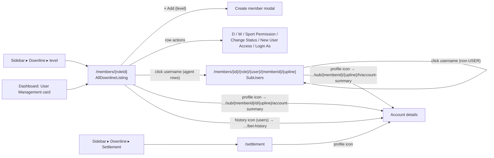

# Admin Module A3: Downline (overview)

**Scope.** Downline is where all user management happens. It covers the role-level lists (`/members/{roleId}`), drilling into an agent's own downline, creating members, member actions (deposit and withdraw, sport permission, status, new-user access, Login As, password), a member's account details, and Settlement.

**Reference.** `rsplay/rsplay-admin@12f0054`, paths relative to `src/`. Roles, the hierarchy and the permission model are explained in the [phase overview](../overview.md#roles-and-the-hierarchy). Read that first.

| File | What it covers |
|---|---|
| this page | Routes, how the pages connect, permissions, findings |
| [member-listing.md](member-listing.md) | The role-level list and the drill-down list: filters, columns, balance strip |
| [create-member.md](create-member.md) | "+ Add" form, partnership (percentage) rule, request |
| [member-actions.md](member-actions.md) | D/W, Sport Permission, Change Status, New User Access, Login As, Change Password |
| [account-details.md](account-details.md) | A member's tabs: summary, statement, bets, P&L, transactions, activity log |
| [settlement.md](settlement.md) | Settling P/L for direct downline, single and bulk |
| [api-inventory.md](api-inventory.md) | Every API in this module |
| [polling-and-frequency.md](polling-and-frequency.md) | When each request runs (no polling) |

---

## Routes

All Downline routes are inside `ProtectedRoute` and `DashboardLayout` (`App.tsx:116-117`).

| Route | Page | Guard | Source |
|---|---|---|---|
| `/members/:id` (`:id` = role id of the level being listed) | `pages/Downline/AllDownlineListing.tsx` | `ModuleRoute "Users"` (read) | `App.tsx:136-137` |
| `/members/:id/:role/:user/:memberid/:upline` | `pages/Downline/SubUsers.tsx` (one agent's downline) | same | `App.tsx:138` |
| `/settlement` | `pages/Settlement/index.tsx` | same | `App.tsx:139` |
| `/members/:id/sub/:memberid/:userType/:uplineId` | `pages/Downline/AccountDetails/AccountDetails.tsx` (tab shell) | `ModuleRoute "Users"` `read` | `App.tsx:141-148` |
| … `index` | `AccountSummary` | parent only | `App.tsx:149` |
| … `/account-summary` | `AccountSummary` | `read` + **`update`** | `App.tsx:150-157` |
| … `/account-statement`, `/bet-history`, `/betting-pl`, `/casino-detail`, `/transaction-history`, `/login-history` | see [account details](account-details.md) | `read` + `detailedView` | `App.tsx:159-208` |

In the account-details route, `:userType` is `d` (direct) or something else (hierarchy). Bet and casino reports send `reportType: 'DIRECT'` only when it is exactly `d` (`BetHistoryDetails/UserSportsBets.tsx:61`). `:uplineId` is passed to the account-summary API as its last path segment (`AccountSummary.tsx:77`).

## How the pages connect

| From | To | Source |
|---|---|---|
| Sidebar Downline children | `/members/{roleId}` | `components/common/EnhancedSidebar.tsx:273-285` |
| Dashboard User Management card | `/members/{roleId}` | `components/DashboardComponents/UserManagementMetrics.tsx:49-51` |
| Agent username in the level list | `/members/{id}/{role}/{username}/{memberId}/{upline}?role={role}` | `AllDownlineListing.tsx:202-207` |
| Non-USER username in the drill-down list | `/members/{id}/{role}/{username}/{memberId}/{upline}` | `SubUsers.tsx:137-142,461-466` |
| Profile icon (level list) | `/members/{id}/sub/{memberId}/d/{upline}/account-summary` | `AllDownlineListing.tsx:470-479,865-873` |
| Bet history icon (user rows) | `/members/{id}/sub/{memberId}/d/{upline}/bet-history` | `AllDownlineListing.tsx:897-904` |
| Profile icon (drill-down) | `/members/{id}/sub/{memberId}/{upline}/h/account-summary`: **the order of `upline` and `h` is reversed** compared with the level list (F3) | `SubUsers.tsx:403,651` |

## Permissions used in this module

For a role user, buttons are enabled from the `Users` module flags (`AllDownlineListing.tsx:61-66`). For the Owner and agents, every flag is `true` (`context/PermissionContext.tsx:44`).

| Flag | Enables |
|---|---|
| `create` | "+ Add {level}" button |
| `update` | D, W, Sport Permission, Change Status, New User Access, Login As, Settlement transfer, Change Password (Account Summary) |
| `detailedView` | profile and bet-history icons |
| `download` | export buttons in account-details tabs |

Some actions also depend on the role itself:

| Element | Shown to | Source |
|---|---|---|
| New User Access column | Owner and role users | `AllDownlineListing.tsx:156-188` |
| Login As column | Owner only | `AllDownlineListing.tsx:524-557` |
| Change Password (Account Summary) | when the member's upline role id equals the logged-in role id | `AccountDetails/AccountSummary.tsx:127,330-351` |

## Findings

All `OBSERVED` from source unless labelled. More detail is on each page.

| # | Finding | Where |
|---|---|---|
| F1 | **"Generate Password" always produces the same password, `asdf1234`.** Both Create Member and Change Password use a fixed string, not a random generator | `Modal/CreateMember.tsx:25-27`; `Modal/PasswordChange.tsx:12-14` (Q-40; **team-confirmed intent**: fixed on purpose for now) |
| F2 | **D and W stay clickable for inactive, suspended and bet-locked members.** The disabled rule is `!canUpdate && isDisable(status)`, so whenever `canUpdate` is true (always for Owner and agents) the status is ignored | `AllDownlineListing.tsx:117-120,446,465,826,844` (Q-41; **team-confirmed defect**: financial actions are allowed only for active members and the backend does not check status) |
| F3 | **The drill-down profile link swaps two route segments.** It builds `…/sub/{id}/{upline}/h/…`, while the route is `…/sub/:memberid/:userType/:uplineId`. Account Summary then calls `/users/account/summary/{id}/h`. Reports still get `HIERARCHY`, because any `userType` other than `d` does | `SubUsers.tsx:403,651`; `App.tsx:142`; `AccountSummary.tsx:77` (Q-42) |
| F4 | **Activity Log ignores the member in the URL.** It loads the member saved in `localStorage.accountSummary` by the last Account Summary visit. The tab list is chosen the same way | `AccountDetails/ActivityLog.tsx:26,35-46`; `AccountDetails/AccountDetails.tsx:21,41-44` (Q-43; **team-confirmed intent**: the local-storage entry is kept in sync with the current member in normal navigation; a hand-typed deep link is the remaining edge case) |
| F5 | **The profile icon is enabled by `detailedView`, but it opens `account-summary`, which needs `update`.** A role user with view-only rights is redirected to `/settings` | `AllDownlineListing.tsx:470-479`; `App.tsx:150-157` (Q-45) |
| F6 | **The drill-down page and every level list show the logged-in account's totals.** The balance strip calls `GET /users/summary` with no member id, not the totals of the agent being viewed | `SubUsers.tsx:51,721`; `AllDownlineListing.tsx:75,979` (Q-50; **team-confirmed intent**) |
| F7 | **The drill-down page's modals cannot be opened.** Sport Permission, Change Status and Password modals are wired up, but no button sets `activeModal` | `SubUsers.tsx:834-867` |
| F8 | **Role ids are hard-coded in two places.** The drill-down default tab is `6`, with fallback ids `3, 4, 13, 5, 6`. The Settlement profile link uses `2`/`3`/`4` and compares against `'SUPERMASTER'`, which never matches `'SUPER MASTER'` | `SubUsers.tsx:58-64,78,93-95`; `Settlement/index.tsx:234-238` (Q-48; **team-confirmed defect**: take ids from `/role/available`) |
| F9 | **A failed status change shows a success-styled toast** (`showToastMessage('success', <error>)`) | `Modal/ChangeStatus.tsx:50-52` (Q-47; **team-confirmed defect**) |
| F10 | **Deposit and withdraw always send the narration "Deposit by Owner" / "Withdraw by Owner"**, also when an agent performs them | `components/common/DepositWithdraw.tsx:120-121` |
| F11 | **Settlement bulk amount nets positive and negative P/L**, while a single transfer sends the absolute value. Team (Q-46): bulk settles the full amount of each selected member; no money moves in a negative direction |  [settlement.md](settlement.md) |
| F12 | **Account Summary shows a hard-coded staging admin URL as "Domain"** for every member, and logs `uplineId` to the console | `AccountDetails/AccountSummary.tsx:83,104-110` (Q-52; **team-confirmed defect**: make it configurable per platform) |
| F13 | **Dead code:** `'password-change'` in the level list's modal map is never set. `getCasinoDetail` is reachable only by typing `…/casino-detail` (no tab). `upsertBetLock` and `getDownlineBetStatus` are not used by these pages | `AllDownlineListing.tsx:935-938`; `AccountDetails.tsx:22-40` |

<!-- Platform-specific (team, 2026-11-25): hidden until this feature is offered on the platform. Remove the comment markers to show it again.
| Coin action | rows on the USER level list | `AllDownlineListing.tsx:849-864` |
| F13 (part) | `CreditLimit` (Credit Reference edit) and `OwnerMfaStatus` (Owner MFA Status) cannot be reached: the edit and MFA buttons are commented out | `AllDownlineListing.tsx:227-237,505-519` |
-->

Questions raised: Q-40 to Q-48, Q-50 and Q-52. Answered by the team on 2026-11-24 except Q-42 and Q-45, which stay open. See [open-questions.md](../../../inventory/open-questions.md).
