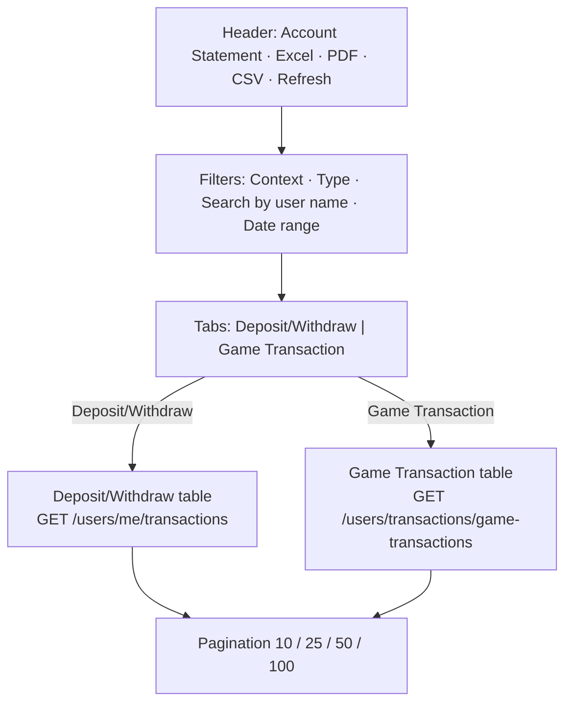

# Admin Module A4: Account Statement (overview)

**Scope.** The **Account Statement** sidebar page at `/rolewise-account-statement` (`pages/RoleWiseAccountStatement/index.tsx`, component `RoleWiseAccountStatement`). It has two tabs, **Deposit/Withdraw** and **Game Transaction**, with filters, a table, pagination, Refresh and Excel / PDF / CSV export.

This is **not** the Account Statement tab inside a Downline member's account details. That tab is documented in [A3 account details](../03-downline/account-details.md) and uses different requests.

**Reference.** `rsplay/rsplay-admin@12f0054`, paths relative to `src/`.

| File | What it covers |
|---|---|
| this page | Route and access, tabs, filters, columns, display rules, export, findings |
| [api-inventory.md](api-inventory.md) | The 3 requests the page makes (AS1-AS3): parameters, response fields, consumer |
| [polling-and-frequency.md](polling-and-frequency.md) | When each request runs (nothing polls) |

---

## Route and access

| Item | Rule | Source |
|---|---|---|
| Route | `/rolewise-account-statement`, wrapped in `ModuleRoute moduleName="Account Statement"` with the default `read` check | `App.tsx:288-295`; `components/ModuleRoute.tsx:38-63 (ModuleRoute)` |
| Owner and agents | Always allowed (`isPrivilegedUser`) | `ModuleRoute.tsx:43,50-51` |
| Role users | Need `Account Statement.read`, otherwise redirected to `/settings` | `ModuleRoute.tsx:50-62` |
| Sidebar | Shown to the Owner and to agents. Role users see it when they have `read` on `Account Statement` | [A1 sidebar](../01-login-and-layout/sidebar.md) |
| Export buttons | Enabled only with `Account Statement.download`. The Owner and agents always pass (`hasModuleAccess` returns `true` for them) | `RoleWiseAccountStatement/index.tsx:51-52`; `components/common/Header.tsx:181-193` |

## Page layout

Only the active tab's query runs. The other is skipped (`skip: isGameTab` / `skip: !isGameTab`, `index.tsx:67-83`).

## Tabs

| Tab | Request | Rows read from | Source |
|---|---|---|---|
| Deposit/Withdraw (default) | [AS1](api-inventory.md#as1-getmytransactions) `GET /users/me/transactions` | `data[]`, `pagination.totalItems` | `index.tsx:48,72-74,85-91` |
| Game Transaction | [AS2](api-inventory.md#as2-getgametransactions) `GET /users/transactions/game-transactions` | `transactions[]`, `pagination.totalItems` | `index.tsx:81-83,85-91` |

Tab labels come from `transectiionTypes` (`utils/constent.ts:155-158`). Switching tabs resets every filter, the date range, the search and the page (`index.tsx:252-256,265-272,346-351`).

Whose rows each tab returns is decided by the backend. AS1 is the logged-in account's own transactions (`/users/me/…`). AS2 has a **Player** column, so it lists game transactions of players (`INFERRED` from the column). The exact scope for each role is `BACKEND CONFIRMATION REQUIRED` (Q-56).

## Filters

| Filter | Options | Sent as | Resets page | Source |
|---|---|---|---|---|
| Context (Deposit/Withdraw tab) | ALL, Deposit, Withdrawal, Bonus, CoinConversion | `context` (omitted for ALL) | yes | `index.tsx:25,57,290-299` |
| Context (Game Transaction tab) | ALL, Won, Lost, Rollback, Bet | `context` (omitted for ALL) | yes | `index.tsx:27,258` |
| Type | ALL, Debit, Credit | `type` (omitted for ALL) | yes | `index.tsx:30,58,302-311` |
| Search ("Search by user name...") | free text, 500 ms debounce | `search` | yes | `index.tsx:59,260-264,318-326` |
| Date range | `DateRangePicker` presets (Today, Yesterday, Last 7 / 30 / 90 days, This month) or From / To dates | `fromDate` = start of the from-day, `toDate` = end of the to-day, both UTC ISO | yes | `index.tsx:60-63,332-340`; `components/common/DateRangePicker.tsx:54-110` |

- **No date range on page open.** `appliedRange` starts as `null`, so the first request has no `fromDate` or `toDate` (`index.tsx:46-47`). What the backend returns without dates is `BACKEND CONFIRMATION REQUIRED` (Q-56).
- **The date range is applied when the picker closes.** The picker calls `onApply` on a click outside it. There is no separate Apply button (`DateRangePicker.tsx:147-157`).
- **Stale search text after a tab switch.** The search input has no `value` prop. A tab switch clears the `search` state but the typed text stays in the box (`index.tsx:318-326,271`, `OBSERVED`).

## Columns

| Column | Value | Display rule | Tabs | Source |
|---|---|---|---|---|
| Transaction Id | `id` | Passed through `formatNumberWithCommas` (en-IN grouping), plus a copy button that copies the raw `id` | both | `index.tsx:99-110` |
| Transaction Time | `timestamp` | `formatReadableDateTime` (en-IN, e.g. "25 Nov 2026, 3:04 pm") | both | `index.tsx:111-115`; `utils/dateutils.ts:71-82` |
| Player | `username` | as is | Game Transaction | `index.tsx:116-123` |
| Description | `narration` | `--` when empty | both | `index.tsx:124-127` |
| Type | `type` lower-cased | Green badge for `credit`, red for `debit`, grey otherwise | both | `index.tsx:128-149` |
| Amount | `amount` | `-` prefix for debit, `+` for everything else (including a missing type). Green for credit, red for debit | both | `index.tsx:150-170` |
| Context | `context` | `formatContextLabel`: `_` becomes a space and camel case is split ("CoinConversion" → "Coin Conversion"). `--` when empty | both | `index.tsx:171-177`; `utils/index.ts:249-257` |
| Status | `status` lower-cased | Badge colour: pending yellow, confirmed blue, approved green, failed and rejected red, others grey. `--` when empty | both | `index.tsx:32-38,178-194` |
| Balance | `availableBalance` | `formatNumberWithCommas` | both | `index.tsx:195-199` |
| From/To | `fromAccount` → `toAccount` | Shown only when both are present, else `--` | Deposit/Withdraw | `index.tsx:200-221` |

`formatNumberWithCommas` turns its input into a number and returns `0` when that fails (`utils/index.ts:107-117`). An `id` that is not numeric therefore shows as **0**, and a numeric one gets thousands separators. The `?? '--'` fallback never applies (Q-56).

No totals row is computed on this page. The `totals` prop is commented out (`index.tsx:369-370`).

## Export

The header's Excel, PDF and CSV buttons call `handleExport('Excel' | 'Pdf' | 'Csv')` (`Header.tsx:49-61`; `index.tsx:228-250`).

| Step | Behaviour | Source |
|---|---|---|
| Empty page | "No Data To Export" toast, no request | `index.tsx:229-231` |
| Request | [AS3](api-inventory.md#as3-exportaccountstatement) `POST /users/transactions/export-userTransaction` with `context`, `type`, `fromDate`, `toDate`, `exportFormat`, and the browser `timezone` | `index.tsx:233-241` |
| Result | `success` → "File Export Successfully"; otherwise the response `message` or "Failted To Export" (spelled this way); error → "Export failed" | `index.tsx:242-249` |
| Where the file appears | The request starts a file job. The file is listed in [Export Report History](../05-export-history/overview.md) | `INFERRED` from `ExportResponse` (`exportId`, `status`) and the shared export flow |

Differences between the export and the table (`OBSERVED`, Q-55):

- **Both tabs use the same export request.** The Game Transaction tab also calls `export-userTransaction`. `exportGameAccountStatement` (`POST users/transactions/export-game-transactions`, `store/api/ExportApi.ts:789-821`) exists but no file calls it.
- **Dates are sent as raw `Date` objects**, not ISO strings. The table sends `startOf('day').toISOString()`, but the export passes `appliedRange.from` / `.to` directly. The admin `apiSlice` has no custom params serializer, so RTK Query's `fetchBaseQuery` turns them into `Date.toString()` text (for example `Tue Nov 25 2026 00:00:00 GMT+0530 (…)`) (`index.tsx:237-238`; `store/api/apiSlice.ts:6-21`, `INFERRED` from RTK's default `URLSearchParams` handling).
- **Search is not sent**, so a filtered-by-user table exports every user.

## Refresh

The header Refresh button waits 500 ms, then refetches the active tab's query (`index.tsx:96,225`; `utils/index.ts:221-232 (useRefresh)`).

## Findings

All `OBSERVED` from source unless labelled.

| # | Finding | Where |
|---|---|---|
| F1 | **The Game Transaction tab exports with the Deposit/Withdraw export request.** The game export endpoint is defined but unused | `index.tsx:227,234`; `ExportApi.ts:789-821` (Q-55) |
| F2 | **Export dates are not ISO strings** and differ from the table's start-of-day / end-of-day values; search is not exported | `index.tsx:234-241` (Q-55) |
| F3 | **Transaction Id is formatted as a number.** A non-numeric id shows as `0`; a numeric id gets commas. The copy button still copies the raw id | `index.tsx:104-105`; `utils/index.ts:107-117` (Q-56) |
| F4 | **No date range by default.** The first request sends no dates, unlike Export History, which defaults to the last 7 days | `index.tsx:46-47,60-63` (Q-56) |
| F5 | **`getGameTransactions` sends the params object as is.** An empty search is sent as `search=` and there is no `ts` cache-buster, while `getMyTransactions` drops empty values and adds `t` | `store/api/commonApi.ts:134-164` |
| F6 | **The search box keeps its text after a tab switch** while the search filter is cleared | `index.tsx:318-326` |
| F7 | **Amount shows `+` when `type` is missing** (anything that is not `debit` is treated as credit for the sign) | `index.tsx:166` |
| F8 | The From/To column reads `fromAccount` / `toAccount`, which the `Transaction` type (AS1) does not declare. Only the game-transaction type has them | `types/accountStatement.ts:1-17,58-59` |

Questions raised: Q-55 and Q-56 in [open-questions.md](../../../inventory/open-questions.md).
