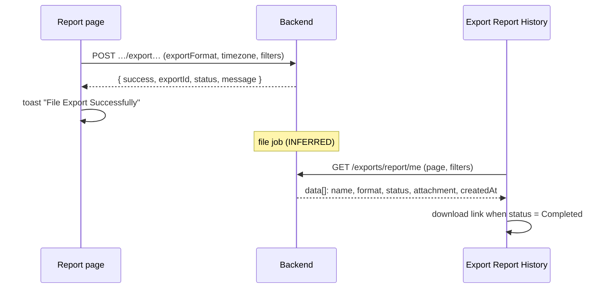

# Admin Module A5: Export Report History (overview)

**Scope.** The **Export Report History** page at `/export` (`pages/ExportHistory/Export.tsx`, component `Export`). It lists the export files the logged-in account has requested from report pages, with their status and a download link. It also lists every export request in the admin app that creates these files.

**Reference.** `rsplay/rsplay-admin@12f0054`, paths relative to `src/`.

| File | What it covers |
|---|---|
| this page | Route and access, how an export reaches this list, filters, columns, download, findings |
| [api-inventory.md](api-inventory.md) | EX1 `getAllExports`, plus the registry of export requests (EX2) |
| [polling-and-frequency.md](polling-and-frequency.md) | When the list loads (nothing polls, there is no Refresh) |

---

## Route and access

| Item | Rule | Source |
|---|---|---|
| Route | `/export`, wrapped in `ModuleRoute moduleName="Export History"` (`read`) | `App.tsx:345-353` |
| Owner and agents | Always allowed | `components/ModuleRoute.tsx:43,50-51` |
| Role users | Need `Export History.read`, otherwise redirected to `/settings` | `ModuleRoute.tsx:50-62` |
| Sidebar | "Export Report History", shown to the Owner and agents; role users need `read` | [A1 sidebar](../01-login-and-layout/sidebar.md) |
| Download | Needs `Export History.download` **and** status `Completed`. The Owner and agents always have `download` | `Export.tsx:20-21,127-129` |

## How an export reaches this list

- Report pages send `exportFormat` as `Excel`, `Pdf` or `Csv` (the header button name, `components/common/Header.tsx:49-61`). This page filters by the same three values.
- The export request returns `ExportResponse { exportId, message, status, success }` (`types/index.ts:1823-1828`). No page reads `exportId` or `status`. That a background job creates the file and later sets `Completed` or `Failed` is `INFERRED` from these fields and the list's statuses.
- Nothing links the report page to this page. The user opens Export Report History from the sidebar.

The full list of export requests and the pages that call them is in [EX2](api-inventory.md#ex2-export-requests-that-feed-this-list).

## Filters

| Filter | Options | Sent as | Resets page | Source |
|---|---|---|---|---|
| Search ("Search by Report Name...") | free text, 500 ms debounce | `search` (omitted when empty) | yes | `Export.tsx:39,155-164`; `hooks/debounce.tsx` (`useDebounce`) |
| Date range | `DateRangePicker` presets or From / To | `fromDate`, `toDate` as `toISOString()` | yes | `Export.tsx:30-38,169-176` |
| Type | All, Excel, Csv, Pdf | `exportFormat` (omitted for All) | **no** | `Export.tsx:43,182-188` |
| Status | All, Completed, Pending, Failed | `status` (omitted for All) | **no** | `Export.tsx:44,190-196` |

**Default range: last 7 days, to the moment the page opened.** Both `appliedRange` and `selectedRange` start as `{ from: now − 6 days, to: now }`, where `now` is fixed when the page mounts (`useMemo`). These are not rounded to start or end of day (`Export.tsx:22,30-38`). A preset or a picked date is rounded by the picker (`DateRangePicker.tsx:35-45,54-110`). The range is applied when the picker closes (click outside).

Type and Status do not reset the page. On page 3, choosing a status that has only one page of results shows an empty table (`Export.tsx:184,192`, `OBSERVED`).

## Columns

| Column | Value | Display rule | Source |
|---|---|---|---|
| S. No. | position | `(page − 1) × size + row + 1` | `Export.tsx:54-63` |
| Report Name | `name` | as is | `Export.tsx:64-68` |
| Date & Time | `createdAt` | `formatReadableDateTime` (en-IN) | `Export.tsx:69-75`; `utils/dateutils.ts:71-82` |
| File Type | `format` | `Pdf` → PDF icon, `Csv` → CSV icon, anything else → Excel icon | `Export.tsx:81-95` |
| Status | `status` | `Completed` green, `Pending` yellow, anything else (for example `Failed`) red | `Export.tsx:96-121` |
| Action | `attachment` | Download icon. A link only when `status === 'Completed'` and the user has `download`; otherwise a faded, disabled icon | `Export.tsx:122-144` |

A "File Size" column is commented out (`Export.tsx:76-80`).

## Download

The link is `<a href={attachment} download target="_blank" rel="noopener noreferrer">` (`Export.tsx:134-137`). The file URL comes from the backend as is. Browsers ignore the `download` attribute for files on another origin, so a cross-origin file opens in a new tab instead of downloading (`INFERRED` from browser behaviour). No request is made through the API layer, so the file host must allow the download without the `Authorization` header.

## Findings

All `OBSERVED` from source unless labelled.

| # | Finding | Where |
|---|---|---|
| F1 | **No auto-refresh and no Refresh button.** A `Pending` export stays `Pending` on screen until a filter, the page or the date range changes, or the page is opened again | `Export.tsx:40-48,148` (Q-57; **team-confirmed fix**: add a Refresh button) |
| F2 | **The default range ends at the moment the page opened.** Exports requested from another tab after that are outside `toDate` until the range is applied again | `Export.tsx:22,30-38` (Q-57) |
| F3 | **Type and Status filters do not reset the page**, unlike search, date and page size | `Export.tsx:182-196` |
| F4 | The table's loader uses `isLoading` only, so filter changes show the old rows until the new response arrives | `Export.tsx:40,210` |
| F5 | Any `format` other than `Pdf` or `Csv` shows the Excel icon | `Export.tsx:86-91` |

Questions raised: Q-57 in [open-questions.md](../../../inventory/open-questions.md).
