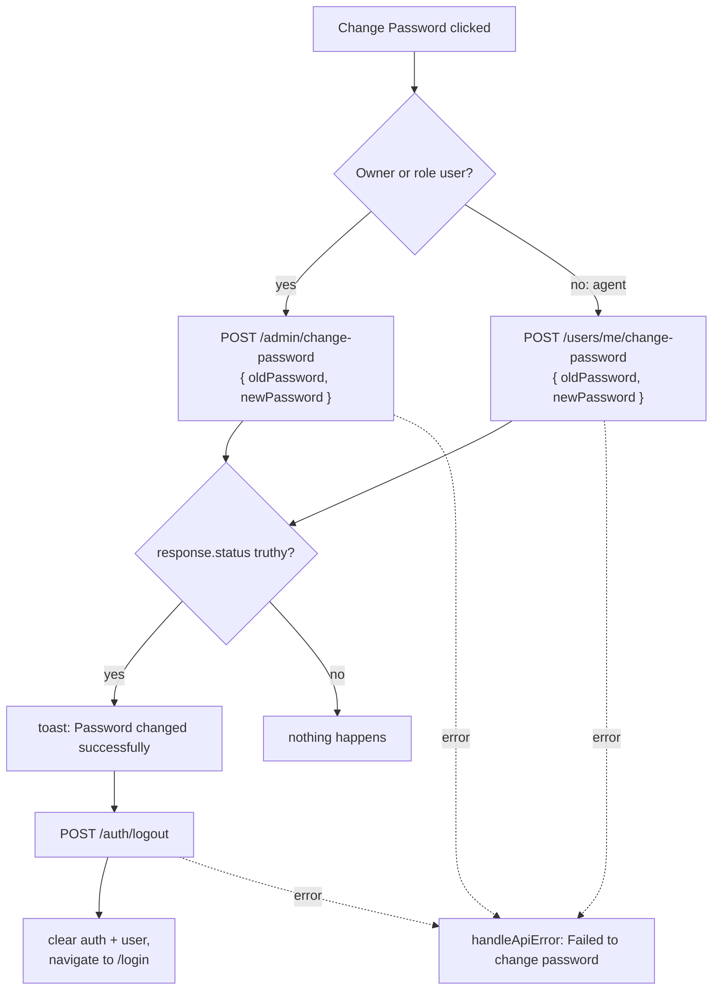

# Admin Module A6: Change Password, Activity Log and Logout (overview)

**Scope.** Three items at the bottom of the sidebar:

| Item | Route | Page |
|---|---|---|
| [Change Password](#change-password) | `/settings` | `pages/settings/ChangePassword.tsx` (`ChangePasswordPage`), using the shared form `components/common/ChangePassword.tsx` (`ChangePassword`) |
| [Activity Log](#activity-log) | `/activity-logs` | `pages/ActivityLogs/index.tsx` (`ActivityLogs`) |
| [Logout](#logout) | — (sidebar button) | already documented in [A1 session and logout](../01-login-and-layout/overview.md#session-and-logout) |

**Reference.** `rsplay/rsplay-admin@12f0054`, paths relative to `src/`.

| File | What it covers |
|---|---|
| this page | Routes and access, the password form and its rules, the activity log table, masking, detail row, export, findings |
| [api-inventory.md](api-inventory.md) | ST1-ST4: password change and logout (linked to A1), activity log list and export |
| [polling-and-frequency.md](polling-and-frequency.md) | When each request runs (nothing polls) |

---

## Change Password

### Route and access

| Item | Rule | Source |
|---|---|---|
| Route | `/settings`, with **no** `ModuleRoute` guard. Any logged-in user can open it | `App.tsx:225-226`; `components/routes/index.tsx:133 (Setting)` |
| Sidebar | "Change Password", always shown to every role | [A1 sidebar](../01-login-and-layout/sidebar.md) |
| Fallback page | When a role user is denied a page, `ModuleRoute` redirects to `/settings`. A role user with no `read` permission anywhere lands here after login | `components/ModuleRoute.tsx:53-62` |

`getRoutePriority` lists a `Change Password` permission key (`ModuleRoute.tsx:33`), but the route itself checks no permission.

### Form

The page renders the shared `ChangePassword` form with the Cancel button hidden (`hideCancelBtn`) (`pages/settings/ChangePassword.tsx:6-21`). The same form is used by the forced "Create Password" modal in the layout, which shows Cancel ([A1 layout](../01-login-and-layout/overview.md#layout-layoutsdashboardlayouttsx)).

| Field | Rule | Message | Source |
|---|---|---|---|
| Current Password | required | "Current password is required" | `utils/validation.tsx:139 (passwordSchema)` |
| New Password | 8 to 20 characters | "Password must be at least 8 characters long" / "Password must not exceed 20 characters" | `validation.tsx:140-143` |
| New Password | must differ from Current Password | "New password must be different from current password" | `validation.tsx:147-150` |
| Confirm Password | required and equal to New Password | "Confirm password is required" / "Passwords don't match" | `validation.tsx:144,151-154` |

Validation runs on every change (`mode: 'onChange'`) (`components/common/ChangePassword.tsx:45-54`). There is no rule for character types (letters, digits, symbols).

### Submit

| Step | Behaviour | Source |
|---|---|---|
| Which request | Owner and role users → `OwnerChangePassword`; agents → `changePassword` ([ST1](api-inventory.md#st1-changepassword--ownerchangepassword)) | `ChangePassword.tsx:62,68-78` |
| Success | Only when the response has a truthy `status`. Then toast, logout ([ST2](api-inventory.md#st2-logout)), clear the auth and user state, and `navigate('/login', { replace: true })` | `ChangePassword.tsx:80-88` |
| Response without `status` | No toast, no logout, the form stays as it is (`INFERRED`, as A1 L8) | `ChangePassword.tsx:80` |
| Error | `handleApiError(err, 'Failed to change password')` | `ChangePassword.tsx:89-91` |

The password change logs the user out with an in-app navigation, not a full page reload as the sidebar Logout does. `apiSlice.util.resetApiState()` is called without `dispatch`, so it does nothing (A1 F7).

### Findings (Change Password)

| # | Finding | Where |
|---|---|---|
| F1 | **The button is disabled only while the agent request runs.** It uses `isLoading` from `changePassword`, not `isOwnerLoading`, so the Owner and role users can submit twice while the first request is still running. **Confirmed fix (Q-58 a):** disable the button, and show "Changing...", while either request or the logout runs (`isLoading || isOwnerLoading || logoutLoading`) | `ChangePassword.tsx:56-57,142-143` (Q-58) |
| F2 | **If logout fails after a successful change, the user sees "Failed to change password"** (the logout call is inside the same `try`) and stays logged in, although the password was changed. **Confirmed fix (Q-58 b):** handle the logout separately (own `try`/`catch`, or ignore its errors) and always clear local auth and redirect after a successful change | `ChangePassword.tsx:80-91` (Q-58) |
| F3 | The `role` prop is passed by the page but never used. The form decides by `useRoleCheck` | `pages/settings/ChangePassword.tsx:7,16`; `ChangePassword.tsx:42,62` |

---

## Activity Log

The logged-in account's own login history: each sign-in attempt with its result, IP address and location.

### Route and access

| Item | Rule | Source |
|---|---|---|
| Route | `/activity-logs`, wrapped in `ModuleRoute moduleName="Activity Logs"` (`read`) | `App.tsx:337-344` |
| Owner and agents | Always allowed | `ModuleRoute.tsx:43,50-51` |
| Role users | Need `Activity Logs.read`, otherwise redirected to `/settings` | `ModuleRoute.tsx:50-62` |
| Export buttons | Need `Activity Logs.download` | `pages/ActivityLogs/index.tsx:22,241` |

A member's activity log inside Downline account details is a different page with a different request (`activity-log/{id}`, [A3 DL22](../03-downline/api-inventory.md#dl22-getloginhistory)).

### Data and filter

- [ST4](api-inventory.md#st4-getactivitylogs) `GET activity-log` with `page`, `limit` and, when a range is applied, `fromDate` / `toDate` (`index.tsx:32-37`).
- **No date range on page open** (`appliedRange` starts `undefined`, `index.tsx:23-27`). The picker's dates are rounded to the start and end of day, then sent with `toISOString()`. The range is applied when the picker closes.
- Pagination 10 / 25 / 50 / 100. `totalItems` is converted with `Number()` (`index.tsx:38,275-285`).
- Refresh waits 500 ms, then refetches (`index.tsx:206`; `utils/index.ts:221-232`).

### Columns

| Column | Value | Display rule | Who sees it | Source |
|---|---|---|---|---|
| S. No. | row position | `row + 1`, restarts at 1 on every page | all | `index.tsx:50-54` |
| Date/Time | `loginAt` | `moment(...).format('MMM DD, YYYY h:mm A')` | all | `index.tsx:55-63` |
| Login Status | `loginStatus` | `Success` → "Login Success" (green), `Failed` → "Login Failed" (red), anything else → "Unknown" (grey) | all | `index.tsx:64-99` |
| IP Address | `ipAddress` | as is, **not masked** | all | `index.tsx:101-105` |
| ISP | `isp` | masked as `*****` until the row's eye icon is clicked | all | `index.tsx:106-118` |
| City / State / Country | `city`, `state`, `country` | joined with ` / `, masked until revealed | all | `index.tsx:119-134` |
| Security | `anonymous.is_tor`, `is_vpn`, `is_proxy`, `is_relay` | a red badge per detected flag (Tor, VPN, Proxy, Relay), or a green "Clean" badge | Owner and role users | `index.tsx:135-165` |
| Connection | `isHosting` | `'true'` → "Hosting", anything else → "Mobile" (intended, Q-59) | Owner and role users | `index.tsx:166-179` |
| Action | — | eye icon toggles masking for that row | all | `index.tsx:182-204` |

Masking is a display choice only. The full ISP and location are in the response (`index.tsx:45-47`), and the user can reveal them with the row's Action button or the detail row; this is intended (team, Q-59).

### Detail row (Owner and role users)

For the Owner and role users, each row expands (`enableAccordion`) into an `InfoCard` with three sections (`index.tsx:262-273`; `components/common/Infocard.tsx`):

| Section | Fields |
|---|---|
| Geographic Information | City, Region (`state`), Country, Continent, Timezone, Postal Code, Coordinates (`longitude, latitude`) |
| Network Information | ISP Name, ASN (`as.asn`), Domain (`as.domain`), Type (`as.type`), IP Address |
| Security & Connection Flags | Anonymous (`isAnonymous`), VPN, Proxy, Tor, Relay ("Detected" / "Not Detected"), Mobile Network (`mobile.name` present), Hosting Provider, Satellite, Anycast |

Empty values show `-`. The detail row is **not** masked, so expanding a row shows the ISP and location even when the table cells are masked (`Infocard.tsx:3,54-76`, `OBSERVED`). This is intended: the masked values are meant to be viewable on request (team, Q-59).

### Export

Excel, PDF or CSV → [ST3](api-inventory.md#st3-exportactivitylog) `POST /activity-log/export` with `fromDate`, `toDate`, `exportFormat`, `timezone` and **`searchByUserId: summary!.id`** (`index.tsx:207-230`). "No Data To Export" is shown when the page has no rows. The result appears in [Export Report History](../05-export-history/overview.md).

`summary` is read from `localStorage.accountSummary` (`index.tsx:28`). The Downline Account Summary page writes that key with the **member last viewed** (`pages/Downline/AccountDetails/AccountSummary.tsx:84-87`). So on this page (`OBSERVED`, Q-54):

- When no member's Account Summary has been opened in this browser, `summary` is `undefined`, `summary!.id` throws inside the `try`, and the user sees "Export failed". No request is sent.
- Otherwise the export asks for the **last-viewed member's** log, while the table shows the logged-in account's own log.

Team (Q-54, 2026-11-25): `POST /activity-log/export` exports the log of the user in `searchByUserId`, and the logged-in account's own log when no id is sent. The id is sent on purpose so the Downline account-details Activity Log exports the viewed member (see also Q-43). By that rule, this page (own log) would export correctly only without `searchByUserId`; whether it should drop the id is the open follow-up.

### Findings (Activity Log)

All `OBSERVED` from source unless labelled.

| # | Finding | Where |
|---|---|---|
| F4 | **Export uses the last-viewed Downline member's id**, or fails with "Export failed" if no member was viewed. The table lists the logged-in account's own log | `index.tsx:28,215-221`; `AccountSummary.tsx:84-87` (Q-54) |
| F5 | "Connection" shows "Hosting" when `isHosting` is `'true'` and "Mobile" otherwise. **Intended** (team, Q-59). `mobile.name` is used only in the detail row's Mobile Network flag | `index.tsx:166-179`; `Infocard.tsx:90-93` |
| F6 | ISP and location are masked in the table and shown in full in the detail row. **Intended** (team, Q-59): the Action button is how the user reveals them | `index.tsx:262-269`; `Infocard.tsx:54-76` |
| F7 | S. No. restarts at 1 on every page (Export History continues the count across pages) | `index.tsx:53` |
| F8 | `isError` is read but not used; a failed request shows an empty table | `index.tsx:32` |
| F9 | `device` and `remark` are in the response type but not shown | `types/index.ts:85-95` |

---

## Logout

The sidebar **Logout** button is part of the layout and is documented in A1: [session and logout](../01-login-and-layout/overview.md#session-and-logout) and [L9 `logout`](../01-login-and-layout/api-inventory.md#l9-logout). In this module, logout also runs after a successful password change (above).

Questions raised: Q-54, Q-58 and Q-59 in [open-questions.md](../../../inventory/open-questions.md). Q-58 is two confirmed fixes; Q-59 is intended behaviour.
